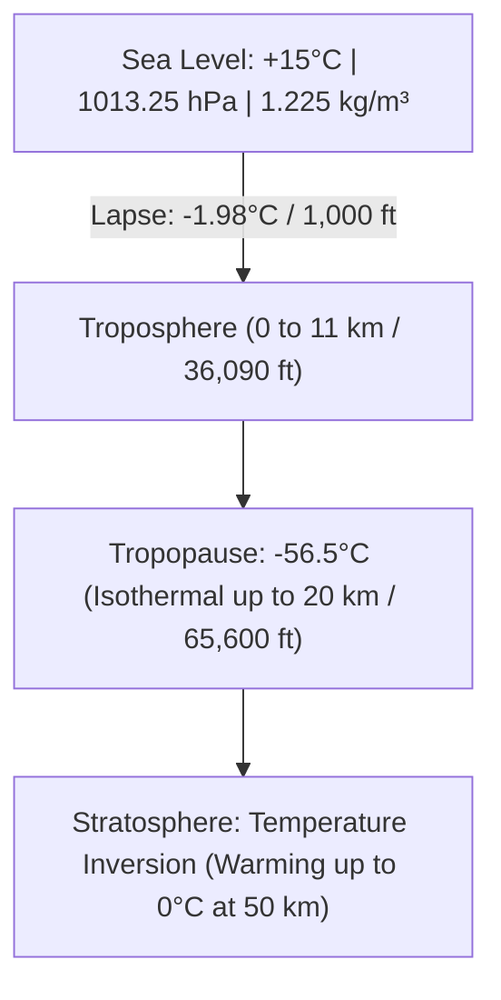
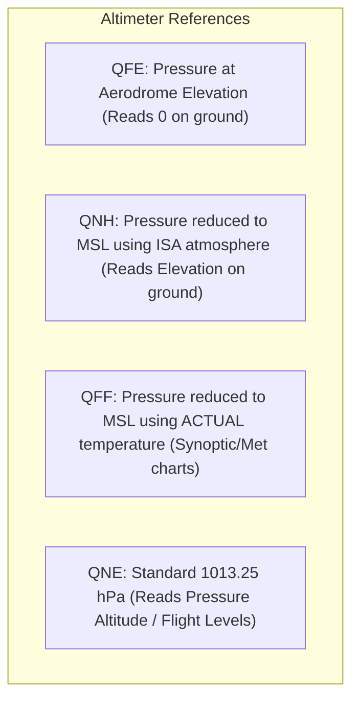
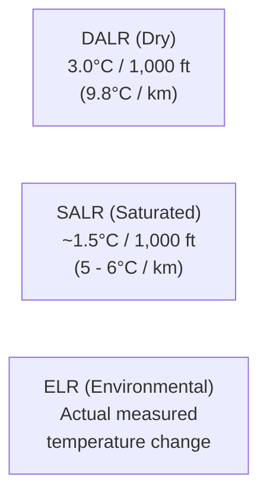
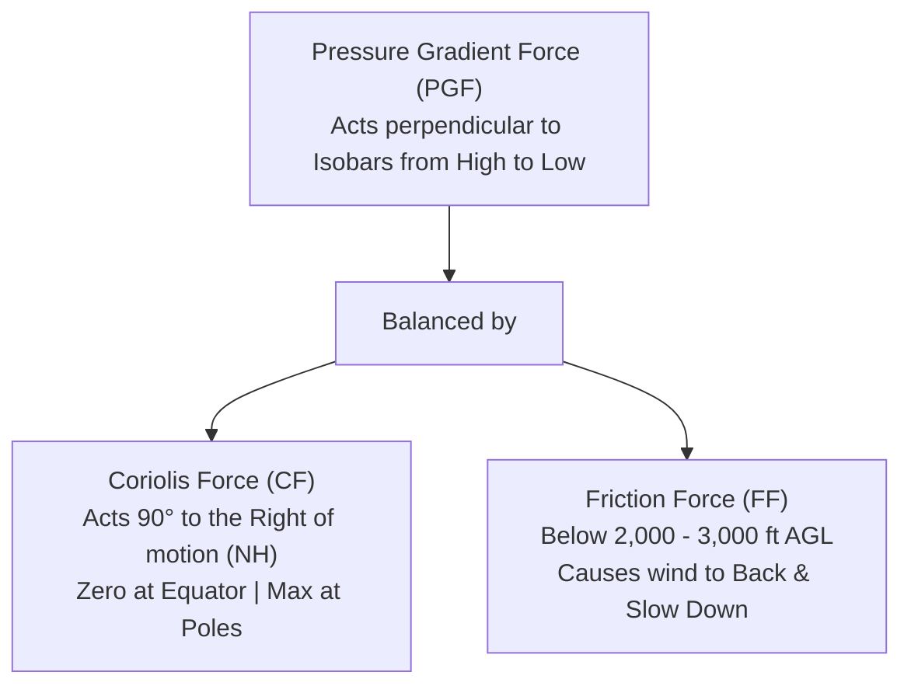

# ✈️ DGCA Aviation Meteorology: Master Formula & Exam Cheat Sheet

> **Essential Exam Reference for DGCA CPL / ATPL Pilots**  
> Strictly aligned with **IC Joshi (Aviation Meteorology)**, Oxford/Nordian, and Volare Question Banks.

---

## 📌 Quick Navigation
1. [ICAO Standard Atmosphere (ISA) Constants & Formulas](#1-icao-standard-atmosphere-isa-constants--formulas)
2. [Pressure Lapse Rate & Altimetry Calculations](#2-pressure-lapse-rate--altimetry-calculations)
3. [Altimeter Setting Conversions (QNH, QFE, QNE, QFF)](#3-altimeter-setting-conversions-qnh-qfe-qne-qff)
4. [True Altitude & Altimeter Error Corrections](#4-true-altitude--altimeter-error-corrections)
5. [Density Altitude & Aircraft Performance](#5-density-altitude--aircraft-performance)
6. [Adiabatic Lapse Rates & Atmospheric Stability](#6-adiabatic-lapse-rates--atmospheric-stability)
7. [Convective Cloud Base (LCL) Quick Formula](#7-convective-cloud-base-lcl-quick-formula)
8. [Wind Forces, Coriolis & Geostrophic Formulas](#8-wind-forces-coriolis--geostrophic-formulas)
9. [Crosswind & Headwind Calculation Rules of Thumb](#9-crosswind--headwind-calculation-rules-of-thumb)
10. [Relative Humidity & Dew Point Relationships](#10-relative-humidity--dew-point-relationships)
11. [Radar Tilt, Echo & Beam Width Geometry](#11-radar-tilt-echo--beam-width-geometry)
12. [Top 15 Golden Mnemonics for DGCA Exams](#12-top-15-golden-mnemonics-for-dgca-exams)

---

## 1. ICAO Standard Atmosphere (ISA) Constants & Formulas

### Core ISA Constants at Mean Sea Level (MSL)
| Parameter | Standard Value (Metric) | Standard Value (Imperial) |
| :--- | :--- | :--- |
| **Temperature ($T_0$)** | **$+15.0^\circ\text{C}$** ($288.15\text{ K}$) | $+59.0^\circ\text{F}$ |
| **Pressure ($P_0$)** | **$1013.25\text{ hPa}$** (or $\text{mb}$) | $29.92\text{ inHg} = 760\text{ mm Hg}$ |
| **Air Density ($\rho_0$)** | **$1.225\text{ kg/m}^3$** | $0.0765\text{ lb/ft}^3$ |
| **Speed of Sound ($a_0$)** | $340.29\text{ m/s}$ | **$661.47\text{ knots}$** |
| **Standard Lapse Rate** | **$6.5^\circ\text{C} / \text{km}$** | **$1.98^\circ\text{C} / 1,000\text{ ft}$** ($\approx 2^\circ\text{C} / 1,000\text{ ft}$) |
| **Tropopause Height** | $11.0\text{ km}$ | **$36,090\text{ ft}$** |
| **Tropopause Temperature** | **$-56.5^\circ\text{C}$** ($216.65\text{ K}$) | $-69.7^\circ\text{F}$ |

### ISA Temperature at Any Flight Level (below 36,090 ft)
$$\mathbf{T_{\text{ISA}} = 15^\circ\text{C} - \left( 2 \times \frac{\text{Altitude in ft}}{1000} \right)}$$

> **Example:** What is ISA Temperature at FL 250?  
> $T_{\text{ISA}} = 15 - (2 \times 25) = 15 - 50 = \mathbf{-35^\circ\text{C}}$

### ISA Deviation ($\Delta \text{ISA}$)
$$\mathbf{\Delta \text{ISA} = \text{OAT} - T_{\text{ISA}}}$$
- If OAT at FL 250 is $-40^\circ\text{C}$: $\Delta \text{ISA} = -40 - (-35) = \mathbf{-5^\circ\text{C}}$ (ISA $-5$).

---

## 2. Pressure Lapse Rate & Altimetry Calculations

Pressure decrease with altitude is non-linear because air is compressible:

| Altitude Band | Height per $1\text{ hPa}$ Drop | Rule of Thumb |
| :--- | :--- | :--- |
| **Sea Level to $5,000\text{ ft}$** | **$27\text{ to }30\text{ ft} / \text{hPa}$** | **$30\text{ ft} / \text{hPa}$** (DGCA standard) |
| **$10,000\text{ ft}$ ($700\text{ hPa}$)** | $37\text{ ft} / \text{hPa}$ | ~ $36-38\text{ ft}$ |
| **$18,000\text{ ft}$ ($500\text{ hPa}$)** | **$50\text{ ft} / \text{hPa}$** | Pressure is half of MSL ($500\text{ hPa}$) |
| **$30,000\text{ ft}$ ($300\text{ hPa}$)** | $75\text{ ft} / \text{hPa}$ | ~ $70-80\text{ ft}$ |
| **$39,000\text{ ft}$ ($200\text{ hPa}$)** | $105\text{ ft} / \text{hPa}$ | ~ $100\text{ ft}$ |

$$\mathbf{\Delta \text{Height (ft)} = \Delta \text{Pressure (hPa)} \times 30}$$

---

## 3. Altimeter Setting Conversions (QNH, QFE, QNE, QFF)

### Mathematical Relationship:
$$\mathbf{\text{QNH} = \text{QFE} + \frac{\text{Aerodrome Elevation (ft)}}{30}}$$
$$\mathbf{\text{QFE} = \text{QNH} - \frac{\text{Aerodrome Elevation (ft)}}{30}}$$

> **Rule:**
> - When Elevation $= 0$ (Sea level airfield) $\implies \mathbf{\text{QNH} = \text{QFE}}$.
> - When Actual Temp $=$ ISA Temp $\implies \mathbf{\text{QNH} = \text{QFF}}$.
> - When Actual Temp $<$ ISA Temp (Cold air) $\implies \mathbf{\text{QFF} > \text{QNH}}$.
> - When Actual Temp $>$ ISA Temp (Warm air) $\implies \mathbf{\text{QFF} < \text{QNH}}$.

---

## 4. True Altitude & Altimeter Error Corrections

The altimeter is calibrated to the ISA atmosphere. Deviations in pressure and temperature cause critical indication errors!

### 1. Pressure Error (Altimeter Subscale Setting Error)
$$\mathbf{\text{True Height} = \text{Indicated Altitude} + [(\text{Actual QNH} - \text{Subscale Setting}) \times 30\text{ ft}]}$$

### 2. Temperature Error Formula (ICAO Rule of 4%)
$$\mathbf{\text{Correction (ft)} = 4 \times \left( \frac{\text{Indicated Altitude}}{1000} \right) \times \Delta \text{ISA}}$$
$$\mathbf{\text{True Altitude} \approx \text{Indicated Altitude} + \left[ 4 \times \left( \frac{\text{Indicated Altitude}}{1000} \right) \times (\text{OAT} - T_{\text{ISA}}) \right]}$$

> **Solved Problem:**  
> An aircraft cruises at FL 100 ($10,000\text{ ft}$). OAT is $-15^\circ\text{C}$. Find True Altitude.  
> 1. $T_{\text{ISA}} = 15 - (2 \times 10) = -5^\circ\text{C}$  
> 2. $\Delta \text{ISA} = -15 - (-5) = -10^\circ\text{C}$  
> 3. $\text{Correction} = 4 \times 10 \times (-10) = \mathbf{-400\text{ ft}}$  
> 4. $\text{True Altitude} = 10,000 - 400 = \mathbf{9,600\text{ ft}}$ *(400 ft lower than indicated! Danger of mountain collision!)*

### The Golden Rule of Altimeter Error:
$$\begin{aligned}
\text{\textbf{High to Low, Look Out Below!}} &\implies \text{Altimeter OVER-READS (Plane is lower than indicated)} \\
\text{\textbf{Low to High, Clear Sky!}} &\implies \text{Altimeter UNDER-READS (Plane is higher than indicated)} \\
\text{\textbf{Cold Air Column Shrinks}} &\implies \text{True Altitude is LOWER than Indicated} \\
\text{\textbf{Warm Air Column Expands}} &\implies \text{True Altitude is HIGHER than Indicated}
\end{aligned}$$

---

## 5. Density Altitude & Aircraft Performance

Density Altitude is Pressure Altitude corrected for non-standard temperature. It represents the altitude in the standard atmosphere at which the air density would be equal to the current air density.

$$\mathbf{\text{Pressure Altitude (PA)} = \text{Elevation} + (1013.25 - \text{QNH}) \times 30}$$
$$\mathbf{\text{Density Altitude (DA)} = \text{PA} + [120 \times (\text{OAT} - T_{\text{ISA}})]}$$

*(Note: In some UK/Oxford texts, 118.8 ft is used; DGCA questions standardly use 120 ft).*

### Operational Consequences of High Density Altitude:
- ❌ **Reduced engine power output** (less oxygen for combustion).
- ❌ **Reduced propeller efficiency & jet thrust**.
- ❌ **Reduced wing lift** at a given True Airspeed (requires higher TAS to produce same IAS).
- ⚠️ **Significantly increased takeoff and landing roll distances**.
- ⚠️ **Reduced rate of climb** and lower service ceiling.

---

## 6. Adiabatic Lapse Rates & Atmospheric Stability

An adiabatic process is one in which no heat is added to or withdrawn from the parcel of air.

### Lapse Rate Values:
- **Dry Adiabatic Lapse Rate (DALR):** $\mathbf{3.0^\circ\text{C} / 1,000\text{ ft}}$ ($0.98^\circ\text{C} / 100\text{ m} \approx 10^\circ\text{C} / \text{km}$). Constant throughout atmosphere.
- **Saturated Adiabatic Lapse Rate (SALR):** Variable! Approx $\mathbf{1.5^\circ\text{C} / 1,000\text{ ft}}$ ($\approx 5^\circ\text{C} / \text{km}$) in warm moist air; approaches DALR in very cold air because cold air holds negligible moisture.
- **Environmental Lapse Rate (ELR):** Variable, actual ambient lapse rate measured by radiosonde.

### Stability Criteria Table:
| Condition | Lapse Rate Relationship | Air Parcel Behavior | Cloud & Weather Type |
| :--- | :--- | :--- | :--- |
| **Absolute Stability** | $\mathbf{\text{ELR} < \text{SALR} < \text{DALR}}$ | Parcel is colder than surroundings $\to$ Sinks back | Stratiform clouds, smooth air, poor visibility, haze/fog |
| **Absolute Instability** | $\mathbf{\text{ELR} > \text{DALR} > \text{SALR}}$ | Parcel is warmer than surroundings $\to$ Accelerates upward | Cumuliform clouds, Cu/Cb, turbulence, showers, good visibility |
| **Conditional Instability**| $\mathbf{\text{SALR} < \text{ELR} < \text{DALR}}$ | Stable if dry (unsaturated); Unstable if saturated! | Stable until lifted to saturation point $\to$ then convective |
| **Isothermal Layer** | $\mathbf{\text{ELR} = 0^\circ\text{C} / 1,000\text{ ft}}$ | Temperature constant with height | Extremely stable |
| **Temperature Inversion** | $\mathbf{\text{ELR} < 0}$ (Temp rises with height)| Temperature increases with height | Maximum stability, traps windshear, fog, pollution |

---

## 7. Convective Cloud Base (LCL) Quick Formula

When warm air rises from the ground, the surface temperature cools at the DALR ($3.0^\circ\text{C}/1000\text{ ft}$) and the dew point cools at the Dew Point Lapse Rate ($\approx 0.5^\circ\text{C}/1000\text{ ft}$).
The rate of closure between Temperature and Dew Point is:
$$\text{Closure Rate} = 3.0 - 0.5 = \mathbf{2.5^\circ\text{C} / 1,000\text{ ft}}$$

$$\mathbf{\text{Cloud Base (ft AGL)} = \frac{\text{Surface Temp (}^\circ\text{C)} - \text{Dew Point (}^\circ\text{C)}}{2.5} \times 1,000}$$
$$\mathbf{\text{Cloud Base (ft AGL)} = 400 \times (\text{Surface Temp} - \text{Dew Point})}$$

> **DGCA Practice Question:**  
> Surface Temp $= +28^\circ\text{C}$, Surface Dew Point $= +18^\circ\text{C}$.  
> $\text{Spread} = 28 - 18 = 10^\circ\text{C}$.  
> $\text{Cloud Base} = 400 \times 10 = \mathbf{4,000\text{ ft AGL}}$.

---

## 8. Wind Forces, Coriolis & Geostrophic Formulas

### 1. Coriolis Force ($F_c$):
$$\mathbf{F_c = 2 m V \Omega \sin\phi}$$
- $m$: Mass of air
- $V$: Wind velocity
- $\Omega$: Earth's angular rotation rate ($7.292 \times 10^{-5}\text{ rad/s}$)
- $\phi$: Latitude
> **Exam Point:** Coriolis force is **zero at the Equator ($\phi = 0^\circ$)** and **maximum at the Poles ($\phi = 90^\circ$)**. It only affects wind **direction**, never wind **speed**!

### 2. Geostrophic Wind Formula ($V_g$):
$$\mathbf{V_g = \frac{1}{2 \rho \Omega \sin\phi} \frac{\Delta P}{\Delta n}}$$
- Geostrophic wind blows **parallel to straight isobars**.
- Inversely proportional to **Latitude ($\sin\phi$)** and **Density ($\rho$)**.
- For the same pressure gradient, geostrophic wind is **stronger at lower latitudes** than at higher latitudes.

### 3. Gradient Wind vs Geostrophic Wind:
- Around a **High Pressure (Anticyclone)**: Centrifugal force acts in the SAME direction as PGF $\implies \mathbf{V_{\text{grad}} > V_{\text{geostrophic}}}$ (**Supergeostrophic**).
- Around a **Low Pressure (Cyclone)**: Centrifugal force acts OPPOSITE to PGF $\implies \mathbf{V_{\text{grad}} < V_{\text{geostrophic}}}$ (**Subgeostrophic**).

### 4. Surface Friction Effect (Planetary Boundary Layer):
In the Northern Hemisphere, crossing down from free atmosphere ($>3,000\text{ ft}$) to the surface:
- Friction reduces wind speed.
- Coriolis force weakens.
- Wind **backs** (turns counter-clockwise) and **crosses isobars toward low pressure**:
  - Over land: Backs by **$\approx 30^\circ$**, speed drops by **$50-60\%$**.
  - Over sea: Backs by **$\approx 10^\circ$**, speed drops by **$30\%$**.

---

## 9. Crosswind & Headwind Calculation Rules of Thumb

$$\mathbf{\text{Crosswind} = \text{Wind Speed} \times \sin(\alpha)}$$
$$\mathbf{\text{Headwind} = \text{Wind Speed} \times \cos(\alpha)}$$
*(where $\alpha = \text{Angle between runway heading and wind direction}$)*

### The Clock Code Rule (Quick Mental Math):
| Angle off Runway ($\alpha$) | Fractional Crosswind | Percentage |
| :--- | :--- | :--- |
| **$15^\circ$** | $\approx 1/4$ of wind speed | **$25\%$** |
| **$30^\circ$** | $\sin(30^\circ) = 1/2$ of wind speed | **$50\%$** |
| **$45^\circ$** | $\sin(45^\circ) \approx 0.70$ of wind speed | **$70\%$** |
| **$60^\circ$ or more** | $\sin(60^\circ) = 0.866 \approx 90\%$ | **Full wind speed ($\approx 90-100\%$)** |

---

## 10. Relative Humidity & Dew Point Relationships

$$\mathbf{\text{Relative Humidity (RH)} = \frac{\text{Actual Vapour Pressure } (e)}{\text{Saturation Vapour Pressure } (e_s)} \times 100\%}$$
$$\mathbf{\text{Relative Humidity (RH)} \approx \frac{\text{Actual Mixing Ratio } (w)}{\text{Saturation Mixing Ratio } (w_s)} \times 100\%}$$

### Key Principles:
1. When temperature rises while moisture content is constant $\implies \mathbf{\text{RH decreases}}$ (air can hold more water vapour).
2. Minimum RH occurs in **afternoon (around 14:00 - 15:00 local time)** when temperature is at its daily maximum.
3. Maximum RH occurs at **sunrise (around 05:00 - 06:00 local time)** when temperature reaches its daily minimum (prime time for radiation fog).
4. When $\text{RH} = 100\% \implies \mathbf{\text{Dry Bulb Temperature} = \text{Wet Bulb Temperature} = \text{Dew Point Temperature}}$.

---

## 11. Radar Tilt, Echo & Beam Width Geometry

Airborne Weather Radars use $3\text{ cm}$ ($X$-band, $9375\text{ MHz}$) for optimal cloud water droplet backscatter.

### Beam Width Formula:
$$\mathbf{\text{Beam Width (degrees)} = \frac{70 \times \lambda}{D}}$$
*(where $\lambda = \text{radar wavelength (3 cm)}$, $D = \text{antenna diameter}$)*

### Height of Target Echo Formula:
$$\mathbf{\text{Height (ft)} = \text{Tilt Angle (degrees)} \times \text{Range (NM)} \times 100}$$

> **Example:** Radar range is $40\text{ NM}$, tilt is $+2^\circ$.  
> The centre of the radar beam is:  
> $\text{Height} = 2 \times 40 \times 100 = \mathbf{8,000\text{ ft above aircraft level}}$.

---

## 12. Top 15 Golden Mnemonics for DGCA Exams

1. **"High to Low, Look Out Below!"**  
   $\to$ Flying from high pressure/temp into low pressure/temp, altimeter over-reads. The aircraft is **lower** than indicated.
2. **"Low to High, Clear Sky!"**  
   $\to$ Flying from low to high, altimeter under-reads. Aircraft is **higher** than indicated.
3. **"Cold to Warm, Do No Harm!"**  
   $\to$ Flying into warmer air, true altitude is higher than indicated.
4. **"Buys Ballot's Law: In Northern Hemisphere, stand with back to wind, Low is on your LEFT."**  
   $\to$ (In Southern Hemisphere, Low is on your RIGHT).
5. **"VEER Clockwise, BACK Counter-Clockwise"**  
   $\to$ Wind veering = turning clockwise ($090^\circ \to 120^\circ$). Wind backing = turning counter-clockwise ($120^\circ \to 090^\circ$).
6. **"Warm Front Clouds Sequence: CI $\to$ CS $\to$ AS $\to$ NS"**  
   $\to$ Cirrus, Cirrostratus (halos!), Altostratus (watery sun), Nimbostratus (continuous rain).
7. **"Clear Ice: Large SLD + High Speed + Near 0°C (-0°C to -10°C)"**  
   $\to$ Freezes slowly, spreads out, smooth, heavy, very dangerous.
8. **"Rime Ice: Small Droplets + Low Speed + Cold (-10°C to -20°C)"**  
   $\to$ Freezes instantaneously, traps air, opaque, milky white, brittle.
9. **"Halos $\to$ Cirrostratus (Ice Crystals refraction)"** vs **"Coronas $\to$ Altocumulus (Water droplets diffraction)"**  
   $\to$ Halo is large ($22^\circ / 46^\circ$), Corona is small surrounding the moon/sun.
10. **"Somali Jet $\to$ Low Level Jet (LLJ) during SW Monsoon"**  
    $\to$ Core at $850\text{ hPa}$ ($1.5\text{ km}$), enhances monsoon moisture feed into western coast of India.
11. **"TEJ (Tropical Easterly Jet) $\to$ Upper Level Jet over India in Summer"**  
    $\to$ Flies East to West at $100-150\text{ hPa}$ ($14-16\text{ km}$), from South China Sea across Peninsular India to Africa.
12. **"Microburst: Diameter < 4 km, Duration < 15 min, Windshear > 30 kt"**  
    $\to$ First encounter strong headwind (IAS increases) $\to$ downdraft $\to$ severe tailwind (IAS drops abruptly, stall danger).
13. **"Advection Fog requires Moderate Wind (8-15 kt)"**  
    $\to$ Warm moist air blowing over cold surface. Day or night, persistent, extensive.
14. **"Radiation Fog requires Calm / Light Wind (2-8 kt), Clear Sky, High RH"**  
    $\to$ Over land only! Dissipates by solar heating or wind $>10\text{ kt}$.
15. **"Cavok Requirements: 10 km+ Visibility, Nil Significant Weather, Nil Cloud below 5,000 ft or MSA (whichever higher), Nil Cb / TCU."**
