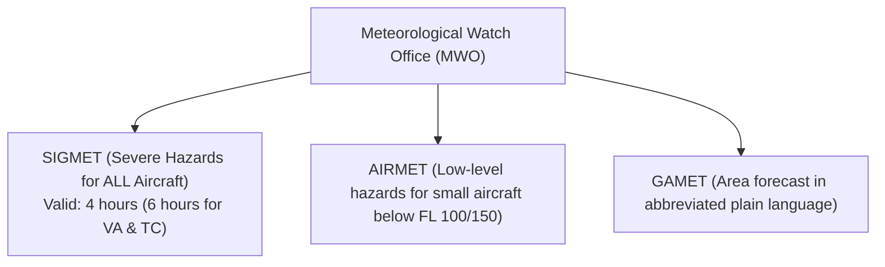

# 🛰️ Master Guide: Aviation Meteorological Codes (METAR, SPECI, TAF & SIGMET)

> **Official Standard for DGCA CPL/ATPL & ICAO Annex 3**  
> Complete operational reference, syntax breakdown, decoding drills, and practice questions.

---

## 📌 Contents
1. [METAR / SPECI Structure & Field Breakdown](#1-metar--speci-structure--field-breakdown)
2. [Present Weather Abbreviations & Descriptor Matrix](#2-present-weather-abbreviations--descriptor-matrix)
3. [Cloud Coverage & Height Decoding](#3-cloud-coverage--height-decoding)
4. [Runway Visual Range (RVR) Syntax & Variations](#4-runway-visual-range-rvr-syntax--variations)
5. [CAVOK, NSC & SKC Rules](#5-cavok-nsc--skc-rules)
6. [TREND Forecast Indicators (NOSIG, BECMG, TEMPO)](#6-trend-forecast-indicators-nosig-becmg-tempo)
7. [TAF (Terminal Aerodrome Forecast) Architecture](#7-taf-terminal-aerodrome-forecast-architecture)
8. [SIGMET, AIRMET & GAMET Overview](#8-sigmet-airmet--gamet-overview)
9. [10 Solved Real-World Decoding Drills](#9-10-solved-real-world-decoding-drills)

---

## 1. METAR / SPECI Structure & Field Breakdown

```mermaid
graph LR
    ID["1. Report Type & Station<br/>(METAR VIDP)"] --> TIME["2. Date/Time UTC<br/>(251200Z)"]
    TIME --> WIND["3. Wind Dir/Speed/Gust<br/>(27015G28KT)"]
    WIND --> VIS["4. Visibility & RVR<br/>(4000 R28/1200U)"]
    VIS --> WX["5. Present Weather<br/>(+TSRA BR)"]
    WX --> CLOUD["6. Cloud Group<br/>(SCT020 BKN030CB)"]
    CLOUD --> TEMP["7. Temp / Dew Point<br/>(28/22)"]
    TEMP --> QNH["8. Altimeter QNH<br/>(Q1008)"]
    QNH --> TREND["9. Trend Forecast<br/>(TEMPO 2000 -TSRA)"]
```



### Full Group Syntax:
`METAR [CCCC] [YYGGggZ] [dddff(Gfmfm)KT] [VVVV] [RDrDr/VRVRVRVRi] [w'w'] [NsNsNshshshs] [T'T'/T'dT'd] [QPhPhPhPh] [REw'w'] [WS RWYDrDr] [TREND]`

| Element | Example | Meaning |
| :--- | :--- | :--- |
| **Type** | `METAR` / `SPECI` | Routine routine report vs Special unexpected deterioration/improvement |
| **Station ICAO** | `VIDP` | Indira Gandhi Int'l Airport, New Delhi |
| **Observation Time** | `081230Z` | 8th day of month, 12:30 UTC |
| **Wind** | `09012G25KT` | Wind from 090° true at 12 kt, gusting to 25 kt |
| **Variable Wind** | `050V140` | Direction varying between 050° and 140° (speed $\ge 3\text{ kt}$) |
| **Calm Wind** | `00000KT` | Calm winds ($<1\text{ kt}$) |
| **Visibility** | `4500` | 4,500 meters prevailing visibility |
| **Minimum Vis** | `1400S` | Minimum visibility 1,400 meters to the South |
| **Runway Visual Range** | `R28/1200U` | Runway 28, RVR 1,200 meters, upward trend |
| **Present Weather** | `+TSRA` | Heavy thunderstorm with rain |
| **Clouds** | `SCT020CB BKN090` | 3-4 oktas CB at 2,000 ft, 5-7 oktas at 9,000 ft |
| **Temperature / DP** | `24/M02` | Temperature $+24^\circ\text{C}$, Dew Point $-2^\circ\text{C}$ (`M` = Minus) |
| **QNH** | `Q1012` | Altimeter setting 1,012 hPa |
| **Recent Weather** | `RETSE` | Recent thunderstorm |
| **Wind Shear** | `WS ALL RWY` | Wind shear on all runways (or `WS RWY29`) |
| **Trend** | `NOSIG` | No significant change expected in next 2 hours |

---

## 2. Present Weather Abbreviations & Descriptor Matrix

Present weather is constructed from:  
**Intensity/Proximity** + **Descriptor** + **Phenomena**

### 1. Intensity & Proximity
| Code | Meaning |
| :--- | :--- |
| `-` | Light |
| *(None)* | Moderate |
| `+` | Heavy / Well developed |
| `VC` | In the vicinity ($8\text{ to }16\text{ km}$ from aerodrome reference point) |

### 2. Descriptors & Phenomena Matrix:
| Descriptor | Code | Precipitation | Code | Obscuration | Code | Other | Code |
| :--- | :--- | :--- | :--- | :--- | :--- | :--- | :--- |
| **Shallow** | `MI` | **Drizzle** | `DZ` | **Mist** | `BR` | **Squall** | `SQ` |
| **Patches** | `BC` | **Rain** | `RA` | **Fog** | `FG` | **Funnel Cloud (Tornado)** | `FC` |
| **Partial** | `PR` | **Snow** | `SN` | **Smoke** | `FU` | **Sandstorm** | `SS` |
| **Drifting** | `DR` | **Snow Grains** | `SG` | **Volcanic Ash**| `VA` | **Duststorm** | `DS` |
| **Blowing** | `BL` | **Ice Pellets** | `PL` | **Widespread Dust** | `DU` | **Dust/Sand Whirls** | `PO` |
| **Shower** | `SH` | **Hail** | `GR` | **Sand** | `SA` | | |
| **Thunderstorm**| `TS` | **Small Hail** | `GS` | **Haze** | `HZ` | | |
| **Freezing** | `FZ` | | | | | | |

> **DGCA High-Frequency Combinations:**
> - `+SHRA`: Heavy shower of rain
> - `-FZDZ`: Light freezing drizzle
> - `VCTS`: Thunderstorm in the vicinity
> - `FZFG`: Freezing fog (supercooled water droplets, creates rime ice!)
> - `MIFG`: Shallow ground fog ($< 2\text{ m}$ height)
> - `BCFG`: Fog patches
> - `BLSN`: Blowing snow (lifted above eye level, $>2\text{ m}$)
> - `DRSN`: Drifting snow (below eye level, $<2\text{ m}$)

---

## 3. Cloud Coverage & Height Decoding

Cloud height is reported in **hundreds of feet above aerodrome elevation (AGL)**.

| Code | Amount in Oktas | Sky Coverage Description |
| :--- | :--- | :--- |
| **`FEW`** | 1 to 2 oktas | Few clouds (trace to quarter sky) |
| **`SCT`** | 3 to 4 oktas | Scattered clouds (partly cloudy) |
| **`BKN`** | 5 to 7 oktas | **Broken clouds (Constitutes a CEILING!)** |
| **`OVC`** | 8 oktas | **Overcast (Complete blanket - CEILING!)** |
| **`VV`** | Sky obscured | Vertical Visibility (e.g., `VV002` = Vertical visibility 200 ft in thick fog) |

### Significant Cloud Types:
Only **two** cloud types are ever explicitly reported in METAR/TAF:
1. **`CB`**: Cumulonimbus (e.g., `SCT025CB`)
2. **`TCU`**: Towering Cumulus (Cumulus congestus of great vertical extent) (e.g., `BKN030TCU`)

---

## 4. Runway Visual Range (RVR) Syntax & Variations

Reported whenever visibility or RVR is less than $1,500\text{ m}$.

Format: `R[Runway]/[Visual Range][Trend]`

| Element | Example | Interpretation |
| :--- | :--- | :--- |
| **Runway** | `R09/` or `R27L/` | Runway 09 or Runway 27 Left |
| **Value** | `0800` | 800 meters |
| **Below minimum instrument** | `M0050` | Less than 50 meters (e.g., `R28/M0050`) |
| **Above maximum instrument** | `P2000` | Greater than 2,000 meters (e.g., `R10/P2000`) |
| **Variability** | `0400V0900` | Variable between 400 m and 900 m |
| **Trend: Upward** | `U` | Improving ($+100\text{ m}$ or more in last 10 min) |
| **Trend: Downward** | `D` | Deteriorating ($-100\text{ m}$ or more in last 10 min) |
| **Trend: No change** | `N` | No distinct change |

---

## 5. CAVOK, NSC & SKC Rules

### The 4 Mandatory Conditions for CAVOK:
The codeword **`CAVOK`** (Ceiling And Visibility OK) replaces Visibility, RVR, Weather, and Cloud groups **ONLY** when ALL four of the following occur simultaneously:
1. ✅ **Visibility is $10\text{ km}$ or more** (reported as `9999` if CAVOK not fully met).
2. ✅ **No cloud below $5,000\text{ ft}$** or below the highest minimum sector altitude (MSA), whichever is higher.
3. ✅ **No Cumulonimbus (`CB`) and no Towering Cumulus (`TCU`)** at any altitude.
4. ✅ **No significant weather phenomena** at or near the aerodrome.

### `NSC` vs `SKC` vs `NCD`:
- **`SKC` (Sky Clear):** Obsolete in auto-reports, manual confirmation of zero clouds.
- **`NSC` (Nil Significant Cloud):** No clouds below $5,000\text{ ft}$ / MSA, no CB, no TCU, but CAVOK cannot be used because visibility $<10\text{ km}$ or significant weather exists.
- **`NCD` (Nil Cloud Detected):** Used in automated stations (`AUTO`) when sensor detects no clouds.

---

## 6. TREND Forecast Indicators (NOSIG, BECMG, TEMPO)

A TREND is a **landing forecast** appended to a METAR, valid for **2 hours** following the observation time.

- **`NOSIG`:** No Significant Change expected during the 2-hour period.
- **`BECMG`:** Becoming. A permanent change in conditions starting at `FM` and completing by `TL`, or occurring generally across the period.
- **`TEMPO`:** Temporary fluctuations lasting **less than 1 hour** on each instance, and covering **less than half** the total period.
- **Time Indicators:**
  - `FM1400`: From 14:00 UTC
  - `TL1530`: Until 15:30 UTC
  - `AT1445`: At 14:45 UTC

---

## 7. TAF (Terminal Aerodrome Forecast) Architecture

Valid for either:
- **Short TAF:** $9\text{ to }12\text{ hours}$ (issued every 3 hours).
- **Long TAF:** $24\text{ to }30\text{ hours}$ (standard for international flights, issued every 6 hours).

### Key Change Groups in TAF:
1. **`FM[DDhhmm]` (From):** Complete, rapid and permanent change starting precisely at the given timestamp. All previous conditions are cancelled!
2. **`BECMG [DDhh/DDhh]`:** Gradual transition occurring between the start and end hour.
3. **`TEMPO [DDhh/DDhh]`:** Temporary variations occurring within the specified window.
4. **`PROB30` / `PROB40`:** Probability of 30% or 40% (never used with FM; only with regular state or TEMPO).
5. **Temperature Group:** `TX[Temp]/[Date][Hour]Z TN[Temp]/[Date][Hour]Z` (Maximum and minimum temperature forecast).

---

## 8. SIGMET, AIRMET & GAMET Overview



### SIGMET Phenomenon Codes:
- **`SEV TURB`**: Severe turbulence
- **`SEV ICE`**: Severe icing (or `SEV ICE (FZRA)`)
- **`SEV MTW`**: Severe mountain waves
- **`HVY DS` / `HVY SS`**: Heavy duststorm / sandstorm
- **`TS`**: Thunderstorms (obscured `OBSC TS`, embedded `EMBD TS`, frequent `FRQ TS`, squall line `SQL TS`)
- **`TC`**: Tropical cyclone (valid 6 hours)
- **`VA`**: Volcanic ash cloud (valid 6 hours)

---

## 9. 10 Solved Real-World Decoding Drills

### Drill 1: Heavy Monsoonal Thunderstorm (Mumbai VABB)
```
METAR VABB 150830Z 24022G38KT 1200 R27/1000D +TSRA BKN008 BKN015CB 27/26 Q0998 WS RWY27 TEMPO 0800 +TSRA=
```
- **Station:** Mumbai (VABB) on the 15th at 08:30 UTC.
- **Wind:** 240° true at 22 kt, gusting to 38 kt.
- **Visibility:** 1,200 meters.
- **RVR:** Runway 27 RVR is 1,000 meters with a deteriorating trend (`D`).
- **Present Weather:** Heavy thunderstorm with rain (`+TSRA`).
- **Clouds:** Broken at 800 ft AGL, Broken Cumulonimbus at 1,500 ft AGL.
- **Temp / Dew Point:** $+27^\circ\text{C} / +26^\circ\text{C}$ (very high moisture!).
- **Altimeter:** QNH 998 hPa (monsoon low).
- **Wind Shear:** Wind shear reported on Runway 27.
- **Trend (2 hours):** Temporarily visibility dropping to 800 meters in heavy thunderstorm and rain.

---

### Drill 2: Winter Radiation Fog (Delhi VIDP)
```
METAR VIDP 220130Z 00000KT 0150 R28/0350N R29/0275D FG VV001 06/06 Q1018 BECMG 0800 FG=
```
- **Station:** New Delhi on 22nd at 01:30 UTC.
- **Wind:** Calm (`00000KT`).
- **Visibility:** 150 meters.
- **RVR:** Runway 28 is 350 m (no change); Runway 29 is 275 m (deteriorating).
- **Weather:** Thick Fog (`FG`).
- **Clouds:** Sky obscured, Vertical Visibility 100 ft (`VV001`).
- **Temp / DP:** $+6^\circ\text{C} / +6^\circ\text{C}$ (100% Relative Humidity).
- **QNH:** 1018 hPa (continental high pressure).
- **Trend:** Becoming 800 m visibility in fog.

---

### Drill 3: Ideal Flying Conditions
```
METAR VOBL 100600Z 08008KT CAVOK 24/14 Q1015 NOSIG=
```
- **Station:** Bengaluru (VOBL), 10th at 06:00 UTC.
- **Wind:** 080° at 8 kt.
- **Weather/Clouds/Vis:** `CAVOK` (Vis $\ge 10\text{ km}$, no clouds below 5,000 ft, no CB/TCU, nil wx).
- **Temp / DP:** $+24^\circ\text{C} / +14^\circ\text{C}$.
- **QNH:** 1015 hPa.
- **Trend:** No significant change in the next 2 hours.

---

### Drill 4: TAF with Change Groups & Probabilities
```
TAF VECC 051000Z 0512/0618 18010KT 6000 HZ SCT025 
    BECMG 0518/0520 12005KT 3000 BR 
    PROB30 TEMPO 0522/0602 0800 FG BKN004 
    FM060500 20015G25KT 8000 SCT030=
```
- **Station:** Kolkata (VECC). Issued 5th at 10:00 UTC, valid from 12:00 UTC on the 5th to 18:00 UTC on the 6th (30 hours).
- **Initial:** Wind 180°/10 kt, Vis 6,000 m in Haze, Scattered clouds at 2,500 ft.
- **Change 1:** Between 18:00 and 20:00 UTC, gradually becoming wind 120°/05 kt, vis 3,000 m in mist (`BR`).
- **Change 2:** 30% probability between 22:00 and 02:00 UTC of temporary visibility dropping to 800 m in Fog with Broken cloud at 400 ft.
- **Change 3:** From 05:00 UTC on the 6th onwards, all previous conditions reset: wind 200°/15 kt gusting 25 kt, vis 8,000 m, scattered at 3,000 ft.
