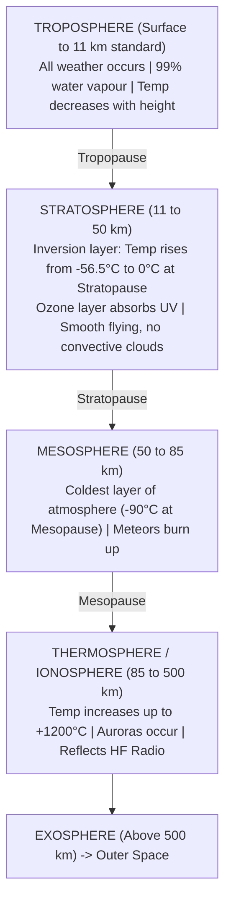
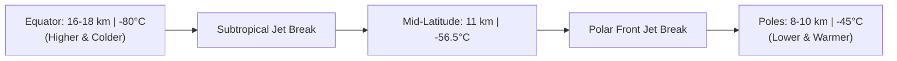

# Chapter 01: Atmosphere, ISA & Vertical Structure

> **DGCA Syllabus:** Physical properties of the atmosphere, composition, extent, vertical division (Troposphere, Stratosphere, Mesosphere, Thermosphere), Tropopause characteristics, ICAO Standard Atmosphere (ISA).  
> **Primary References:** IC Joshi Chapter 1; Oxford/Nordian Chapter 1; Air Meteorology Notes Page 1-3.

---

## 🚀 1. Keyword Core Concepts

- **Atmosphere:** Gaseous envelope surrounding the Earth, rotating with it, bound by gravity.
- **Permanent Gas Composition (Dry Clean Air up to 80 km):**
  - **Nitrogen ($N_2$):** **$78.08\%$** by volume (majority).
  - **Oxygen ($O_2$):** **$20.95\%$** ($\approx 21\%$) by volume (supports combustion and life).
  - **Argon ($Ar$):** **$0.93\%$** by volume (inert gas).
  - **Carbon Dioxide ($CO_2$):** **$0.04\%$** (greenhouse gas, absorbs terrestrial radiation).
  - *Memory Code:* **N-O-A-C** ($78\% - 21\% - 1\% - 0.04\%$).
- **Variable Gases:**
  - **Water Vapour ($H_2O$):** $0\%$ to $4\%$ by volume. Concentrated strictly in lower troposphere ($<5\text{ km}$). Primary driver of weather!
  - **Ozone ($O_3$):** Concentrated in **Stratosphere ($20-50\text{ km}$)**, maximum concentration at **$25\text{ km}$** ($75,000\text{ ft}$). Absorbs harmful solar Ultraviolet (UV-B/UV-C) radiation.
- **Atmospheric Mass Distribution:**
  - **$50\%$** of total mass lies below **$18,000\text{ ft}$** ($5.5\text{ km}$ / $500\text{ hPa}$).
  - **$75\%$** of total mass lies below **$36,000\text{ ft}$** ($11\text{ km}$ / $250\text{ hPa}$).
  - **$99\%$** of total mass lies below **$32\text{ km}$** ($100,000\text{ ft}$ / $10\text{ hPa}$).

---

## 📊 2. Vertical Structure of the Atmosphere

### Layer Characteristics Comparison:
| Layer | Height Range | Temperature Trend | Key Aviation Significance |
| :--- | :--- | :--- | :--- |
| **Troposphere** | Surface to $8-18\text{ km}$ | **Decreases** at $2^\circ\text{C} / 1,000\text{ ft}$ ($6.5^\circ\text{C}/\text{km}$) | Contains almost all weather, water vapour, clouds, convection, and turbulence. |
| **Tropopause** | Boundary layer | **Isothermal** (constant temp) | Boundary lid on convection; jet stream cores and maximum CAT lie just below it. |
| **Stratosphere** | Tropopause to $50\text{ km}$ | **Increases** (temperature inversion due to Ozone) | Excellent cruising conditions, free of convective clouds (except occasional volcanic ash or mother-of-pearl clouds). |
| **Mesosphere** | $50\text{ km}$ to $85\text{ km}$ | **Decreases** to $-90^\circ\text{C}$ (coldest zone) | Noctilucent clouds; meteors burn up. |
| **Thermosphere** | $85\text{ km}$ to $500\text{ km}$| **Increases** rapidly ($>1000^\circ\text{C}$) | Ionized gases; reflects HF communications; Auroras. |

---

## 🌡️ 3. The Tropopause: High-Yield Exam Facts

- **Definition:** The transition boundary between Troposphere and Stratosphere where the lapse rate decreases to **$2^\circ\text{C}/\text{km}$ or less** for a depth of at least $2\text{ km}$.
- **Variation with Latitude:**
  - **Equator:** Higher and colder! Height = **$16-18\text{ km}$ ($55,000\text{ ft}$)**; Temp = **$-75^\circ\text{C}\text{ to }-80^\circ\text{C}$**.
  - **Poles:** Lower and warmer! Height = **$8-10\text{ km}$ ($26,000-30,000\text{ ft}$)**; Temp = **$-45^\circ\text{C}\text{ to }-50^\circ\text{C}$**.
  - **Mid-latitudes:** Height = **$11\text{ km}$ ($36,000\text{ ft}$)**; Temp = **$-56.5^\circ\text{C}$**.
- **Variation with Season:**
  - Higher and colder in **Summer** than in **Winter**.
- **Tropopause Breaks:**
  - The tropopause is not continuous. It has distinct breaks / steps between Tropical, Subtropical, and Polar air masses.
  - **Jet stream cores** reside in these tropopause breaks!

---

## 📐 4. ICAO Standard Atmosphere (ISA)

Because the real atmosphere is constantly fluctuating, ICAO established a baseline reference:

- **Mean Sea Level Pressure ($P_0$):** **$1013.25\text{ hPa}$** ($29.92\text{ inHg} = 760\text{ mm Hg} = 14.7\text{ psi}$).
- **Mean Sea Level Temperature ($T_0$):** **$+15.0^\circ\text{C}$** ($288.15\text{ K}$).
- **Mean Sea Level Density ($\rho_0$):** **$1.225\text{ kg/m}^3$**.
- **Standard Lapse Rate (Troposphere up to 11 km):** **$1.98^\circ\text{C} / 1,000\text{ ft}$** ($\approx 2^\circ\text{C}/1,000\text{ ft}$ or $6.5^\circ\text{C}/\text{km}$).
- **Standard Tropopause:** **$11.0\text{ km}$ ($36,090\text{ ft}$)** at **$-56.5^\circ\text{C}$**.
- **Stratosphere ($11\text{ km}$ to $20\text{ km}$):** **Isothermal** at $-56.5^\circ\text{C}$.
- **Stratosphere ($20\text{ km}$ to $32\text{ km}$):** Temperature **increases at $+1.0^\circ\text{C}/\text{km}$**.

---

## ⚠️ 5. DGCA Trap Points & Must-Know Mnemonics

1. ⚠️ **The Equator Tropopause is COLDER than the Pole Tropopause!**  
   *Trap:* Candidates intuitively guess the Equator is warmer. The surface is warmer, causing massive vertical convective expansion that pushes the tropopause up to 18 km, allowing it to cool to $-80^\circ\text{C}$!
2. ⚠️ **The Stratosphere has a Temperature INVERSION:**  
   Temperature increases with height due to UV absorption by ozone ($O_3$).
3. ⚠️ **Water Vapour is NOT permanent:**  
   Permanent gases maintain a constant percentage ratio up to 80 km. Water vapour varies ($0-4\%$).

---

## 📝 6. Practice Exam Questions (From Question Bank)

#### Q1 (Ref #280): How does the height of the tropopause normally vary with latitude in the northern hemisphere?
- **A:** It remains constant throughout the year.
- **B:** It decreases from south to north.
- **C:** It remains constant from north to south.
- **D:** It increases from south to north.

<b>View Answer</b>

<b>Correct Answer: Option B</b> (It decreases from ~18 km at the equator/south to ~8 km at the pole/north).

#### Q2 (Ref #276): The temperature at FL 110 is -5°C. What will the temperature be at FL 50 if the ICAO standard lapse rate is applied?
- **A:** +3°C
- **B:** 0°C
- **C:** -3°C
- **D:** +7°C

<b>View Answer</b>

<b>Correct Answer: Option D</b> (FL 110 to FL 50 is a descent of 6,000 ft. At 2°C/1000 ft, temperature increases by +12°C. -5 + 12 = +7°C).

#### Q3 (Ref #305): What is the approximate composition of the dry atmosphere by volume?
- **A:** 78% Nitrogen, 21% Oxygen, 1% other gases.
- **B:** 50% Nitrogen, 50% Oxygen.
- **C:** 21% Nitrogen, 78% Oxygen, 1% Argon.
- **D:** 70% Nitrogen, 20% Oxygen, 10% Carbon Dioxide.

<b>View Answer</b>

<b>Correct Answer: Option A</b>.

