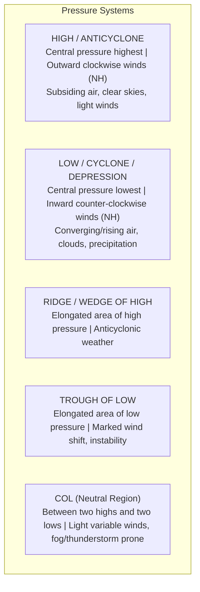
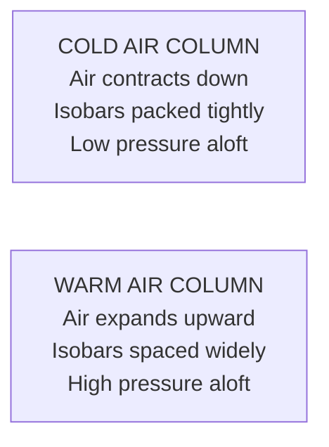
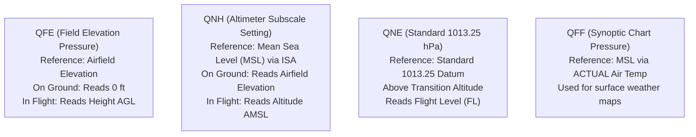
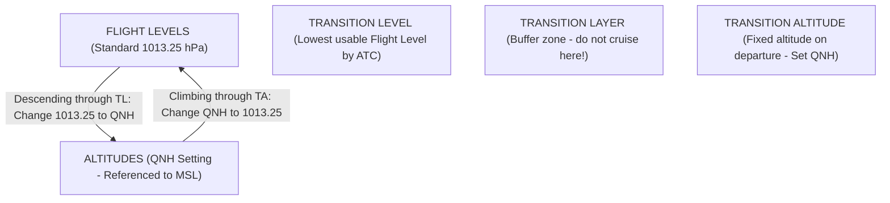

# Chapter 02: Atmospheric Pressure & Altimetry

> **DGCA Syllabus:** Atmospheric pressure definition, units, isobars, pressure systems (High, Low, Trough, Ridge, Col), pressure lapse rate, altimeter working principle, QNH, QFE, QNE, QFF, altimeter errors (pressure and temperature errors), Transition Altitude (TA), Transition Level (TL).  
> **Primary References:** IC Joshi Chapter 2; Oxford/Nordian Chapters 2 & 3; Volare Question Bank.

---

## 🚀 1. Keyword Core Concepts

- **Atmospheric Pressure:** Force exerted by the weight of a column of air over a unit horizontal area.
  - At sea level: $\approx 1.033\text{ kg/cm}^2 = 14.7\text{ psi}$.
- **Units:**
  - **Hectopascal (hPa):** Standard SI unit. $1\text{ hPa} = 100\text{ Pa} = 1\text{ millibar (mb)}$.
  - **Inches of Mercury (inHg):** Used in North America. $1013.25\text{ hPa} = 29.92\text{ inHg}$.
  - **Millimeters of Mercury (mmHg):** $1013.25\text{ hPa} = 760\text{ mmHg}$.
- **Isobar:** Line joining places of equal atmospheric pressure reduced to Mean Sea Level (MSL).
  - Drawn at standard intervals of $2\text{ hPa}$ or $4\text{ hPa}$.
  - Close isobars $\implies$ Steep pressure gradient $\implies$ Strong winds!
  - Wide isobars $\implies$ Weak pressure gradient $\implies$ Light winds!

---

## 📊 2. Synoptic Pressure Systems



### Comparative Breakdown:
| Feature | Cyclone (Low / Depression) | Anticyclone (High) | Trough | Ridge | Col |
| :--- | :--- | :--- | :--- | :--- | :--- |
| **Pressure Pattern** | Enclosed Low | Enclosed High | 'V' or 'U' shaped isobar extension from Low | Elongated extension from High | Saddle region between 2 Highs & 2 Lows |
| **Vertical Air Motion**| **Ascending (upward)** | **Descending (subsiding)** | Ascending | Descending | Variable / Weak |
| **Associated Weather** | Clouds, turbulence, rain, storms | Clear skies, calm winds, radiation fog/smog | Cloud bands, showers, windshear | Fine, settled weather | In summer: thunderstorms; in winter: dense fog |

---

## 📐 3. Vertical Pressure Lapse Rate & Air Columns

Because air is compressible, pressure drops rapidly near the ground and more slowly higher up:

```
Altitude Range         Pressure Lapse Rate
0 to 5,000 ft          1 hPa = 30 ft (Standard DGCA constant)
10,000 ft (700 hPa)    1 hPa = 37 ft
18,000 ft (500 hPa)    1 hPa = 50 ft (Half MSL pressure)
30,000 ft (300 hPa)    1 hPa = 75 ft
39,000 ft (200 hPa)    1 hPa = 100 ft
```

### Warm vs Cold Air Columns:
- **Cold Air Column:** Cold air is dense and contracts downward. Pressure drops **faster** with height.
- **Warm Air Column:** Warm air is light and expands upward. Pressure drops **slower** with height.
- **Key Exam Consequence:** At any high altitude level (e.g., $10,000\text{ ft}$), the pressure is **HIGHER over warm air** and **LOWER over cold air**!



---

## 🎛️ 4. Altimeter Pressure Settings: QNH, QFE, QNE, QFF



### Mathematical Formulas:
$$\mathbf{\text{QNH} = \text{QFE} + \frac{\text{Aerodrome Elevation (ft)}}{30}}$$
$$\mathbf{\text{QFE} = \text{QNH} - \frac{\text{Aerodrome Elevation (ft)}}{30}}$$

### The QNH vs QFF Comparison Table:
| Condition | QNH vs QFF Relationship |
| :--- | :--- |
| **Airfield at Sea Level (Elevation = 0)** | $\mathbf{\text{QNH} = \text{QFE} = \text{QFF}}$ |
| **Actual Temperature = ISA Temperature** | $\mathbf{\text{QNH} = \text{QFF}}$ |
| **Air column is COLDER than ISA ($\text{OAT} < \text{ISA}$)** | $\mathbf{\text{QFF} > \text{QNH}}$ |
| **Air column is WARMER than ISA ($\text{OAT} > \text{ISA}$)** | $\mathbf{\text{QFF} < \text{QNH}}$ |

---

## ⚠️ 5. Altimeter Errors & The Golden Rules

### 1. Pressure Error (Altimeter Subscale Setting Error)
If a pilot flies from an area of High pressure into Low pressure without resetting the altimeter:
- The subscale remains set to the higher pressure.
- The instrument measures ambient low pressure and assumes the aircraft has climbed.
- It indicates a higher altitude than the aircraft is actually flying!
- **Result:** Aircraft is flying **dangerously LOWER than indicated**!

$$\mathbf{\text{True Altitude} = \text{Indicated Altitude} + [(\text{Current QNH} - \text{Subscale Setting}) \times 30\text{ ft}]}$$

### 2. Temperature Error Formula
$$\mathbf{\text{Correction (ft)} = 4 \times \left( \frac{\text{Indicated Altitude}}{1,000} \right) \times (\text{OAT} - T_{\text{ISA}})}$$

### The Universal Golden Rule:
$$\begin{aligned}
\mathbf{\text{"High to Low, Look Out Below!"}} &\implies \text{Altimeter OVER-READS (You are LOWER than indicated!)} \\
\mathbf{\text{"Low to High, Clear Sky!"}} &\implies \text{Altimeter UNDER-READS (You are HIGHER than indicated!)} \\
\mathbf{\text{"Cold to Warm, Do No Harm!"}} &\implies \text{You are HIGHER than indicated} \\
\mathbf{\text{"Warm to Cold, Danger Foretold!"}} &\implies \text{You are LOWER than indicated (True Alt < Indicated)}
\end{aligned}$$

---

## 🛫 6. Transition Altitude, Transition Level & Transition Layer



- **Transition Altitude (TA):** Fixed published altitude for an aerodrome. During climb, at or above TA, altimeter setting is switched from local **QNH to Standard 1013.25 hPa**.
- **Transition Level (TL):** The lowest available flight level above TA, determined dynamically by ATC depending on the local QNH.
- **Transition Layer:** Airspace between TA and TL. Used only for climbing/descending; level cruising is strictly prohibited.
- **Formula:**
  - When $\text{QNH} \ge 1013.25\text{ hPa} \implies \text{Transition Layer thickness is maximum}$.
  - When $\text{QNH} < 1013.25\text{ hPa} \implies \text{Transition Layer thickness is minimum}$.

---

## 📝 7. Practice Exam Questions (From Question Bank)

#### Q1 (Ref #274): The QNH is equal to the QFE if:
- **A:** The elevation = 0.
- **B:** T actual = T standard.
- **C:** T actual > T standard.
- **D:** T actual < T standard.
<details><summary><b>View Answer</b></summary>
<b>Correct Answer: Option A</b> (At sea level, elevation is 0, so QNH = QFE).
</details>

#### Q2 (Ref #383): You fly from airfield A (QNH 1020 hPa) to airfield B (QNH 1000 hPa) at an indicated altitude of 3,000 ft. You forget to reset your altimeter. When over airfield B, your true altitude is:
- **A:** 3,600 ft.
- **B:** 3,000 ft.
- **C:** 2,400 ft.
- **D:** 3,200 ft.
<details><summary><b>View Answer</b></summary>
<b>Correct Answer: Option C</b>  
<i>Explanation:</i> High to Low, look out below! Pressure drop = $1020 - 1000 = 20\text{ hPa}$.  
Height difference = $20 \times 30 = 600\text{ ft}$.  
Actual True Altitude = $3000 - 600 = \mathbf{2,400\text{ ft}}$.
</details>

#### Q3 (Ref #288): In an anticyclone (High Pressure system), the weather is typically characterized by:
- **A:** Overcast clouds, strong turbulence, and severe precipitation.
- **B:** Subsiding air, light winds, clear skies, and potential radiation fog.
- **C:** Continuous squalls and towering cumulonimbus clouds.
- **D:** Steep pressure gradient and hurricane-force winds.
<details><summary><b>View Answer</b></summary>
<b>Correct Answer: Option B</b>.
</details>
