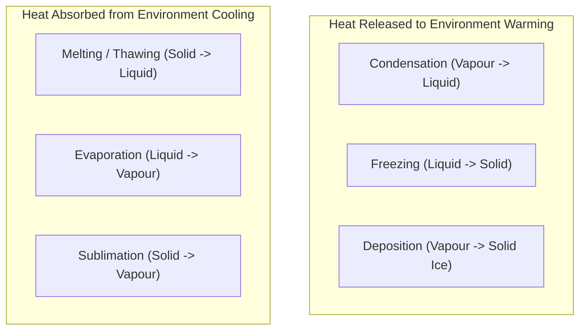
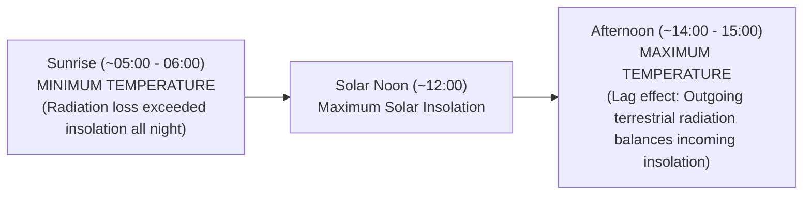
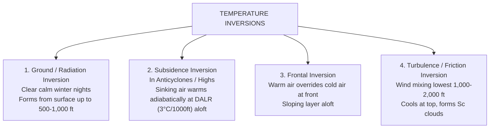

# Chapter 03: Temperature, Heat Transfer & Inversions

> **DGCA Syllabus:** Heating and cooling of the atmosphere, radiation (solar vs terrestrial), conduction, convection, advection, latent heat of phase changes, diurnal variation of temperature, temperature inversions (types, formation, and aviation hazards).  
> **Primary References:** IC Joshi Chapter 3; Air Meteorology Notes Page 1-2; Oxford/Nordian Chapter 1; Volare Question Bank.

---

## 🚀 1. Keyword Core Concepts

- **Atmosphere is Heated from BELOW, Not from Above!**
  - Solar radiation passes through the atmosphere with very little direct absorption.
  - The ground absorbs incoming solar short-wave radiation, heats up, and re-radiates **terrestrial long-wave infrared radiation**, which is absorbed by greenhouse gases ($H_2O$ vapour and $CO_2$) in the lower atmosphere.
- **Heat Transfer Mechanisms:**
  - **Radiation:** Transfer of energy by electromagnetic waves without requiring a material medium.
    - *Solar Radiation (Insolation):* Short-wave ($0.15\text{ to }4.0\text{ }\mu\text{m}$), visible and UV.
    - *Terrestrial Radiation:* Long-wave ($4.0\text{ to }100\text{ }\mu\text{m}$), infrared. Occurs continuously day and night.
  - **Conduction:** Heat transfer by direct molecular contact. Air is a very poor conductor; conduction only affects the thin layer in direct contact with the ground (first few centimeters/inches).
  - **Convection:** Heat transfer by vertical buoyant motion of warm, less dense air parcels. Creates thermals, cumulus clouds, and thunderstorms.
  - **Advection:** Heat transfer by the **horizontal movement** of an air mass (e.g., warm air blowing over a cold ocean surface, triggering advection fog).
  - **Turbulence / Mechanical Mixing:** Eddies caused by wind friction against surface irregularities mixing warm and cold air layers.

---

## 🔄 2. Latent Heat & Phase Changes (From Handwritten Notes)

### Key Values & Exam Facts:
- **Latent Heat of Evaporation / Condensation:** $\approx \mathbf{2.5 \times 10^6\text{ J/kg}}$ ($597\text{ cal/g}$).
- **Latent Heat of Fusion (Melting / Freezing):** $\approx \mathbf{3.34 \times 10^5\text{ J/kg}}$ ($80\text{ cal/g}$).
- **Sensible Heat:** Heat that causes a change in temperature that can be measured with a thermometer. Contributes $\mathbf{\approx 23\%}$ to total atmospheric heating.
- **Latent Heat Release:** The primary engine powering thunderstorms, tropical revolving storms (cyclones), and vertical updrafts!

---

## ☀️ 3. Diurnal Variation of Surface Temperature

### Influencing Factors:
1. **Cloud Cover:**
   - Day: Clouds reflect incoming solar radiation $\implies$ Lower maximum day temperature.
   - Night: Clouds absorb and re-radiate terrestrial heat back to ground $\implies$ Higher minimum night temperature (warmer night).
   - *Result:* **Clouds drastically reduce the diurnal temperature range.**
2. **Wind Speed:**
   - Calm winds: Pronounced cooling at surface, large diurnal range.
   - Strong winds: Mixes air mechanically, distributes heat over a deeper layer $\implies$ Smaller diurnal range.
3. **Moisture Content (Humidity):**
   - Humid tropical climates have a small diurnal range (water vapour traps heat).
   - Dry desert climates have extreme diurnal ranges ($>25^\circ\text{C}$ difference between day and night).
4. **Surface Nature (Land vs Sea):**
   - Land has low specific heat capacity, heats up and cools down rapidly.
   - Water has high specific heat capacity, transparent (heat penetrates deep), constantly mixes, and evaporates $\implies$ **Diurnal range of sea surface temperature is $<1^\circ\text{C}$!**

---

## 🛑 4. Temperature Inversions: Complete Classification

An inversion occurs when temperature **INCREASES with altitude** ($\text{ELR} < 0$). It acts as an impenetrable lid to vertical air motion.

### The 4 Major Inversion Types:
| Inversion Type | Formation Mechanism | Typical Level | Associated Cloud/Weather |
| :--- | :--- | :--- | :--- |
| **Ground / Radiation** | Rapid terrestrial radiative cooling of ground on clear, calm night | Surface to $1,000\text{ ft}$ AGL | Radiation fog, heavy ground frost, dense smog |
| **Subsidence** | Slow sinking (subsidence) of air in High pressure; warms adiabatically at DALR ($3^\circ\text{C}/1000\text{ ft}$) | Upper levels ($3,000\text{ to }10,000\text{ ft}$) | Clear skies, haze layer, persistent dry weather |
| **Frontal** | Warm air mass overrunning a denser cold air mass at a frontal zone | Sloping aloft ($2,000\text{ to }15,000\text{ ft}$) | Ns, As, continuous rain, freezing rain hazard |
| **Turbulence / Friction** | Strong surface wind mixing the boundary layer; top cools adiabatically | Top of friction layer ($1,500\text{ to }3,000\text{ ft}$) | Stratocumulus (Sc) cloud deck |

---

## ✈️ 5. Aviation Hazards of Temperature Inversions

1. **Severe Degradation of Visibility:**  
   - Inversions trap all smoke, pollutants, moisture, and dust beneath the inversion base.
   - Forms a sharp, clearly visible "haze line" from above.
2. **Low-Level Wind Shear (LLWS):**  
   - The air above the inversion is uncoupled from ground friction and may blow rapidly (Low Level Jet).
   - An aircraft on takeoff climb or final approach crossing the inversion layer encounters abrupt changes in airspeed, pitch, and glide path.
3. **Severe Turbulence:**  
   - Intense wind shear generates violent mechanical turbulence right across the inversion boundary.
4. **Carburettor & Airframe Icing:**  
   - In frontal inversions with rain falling from warm air into sub-zero cold air below, **freezing rain (FZRA)** forms, causing catastrophic clear ice accretion!

---

## 📝 6. Practice Exam Questions (From Question Bank)

#### Q1 (Ref #271): How would you characterise an air temperature of -15°C at the 700 hPa level over western Europe?
- **A:** Low
- **B:** High
- **C:** Within +/-5°C of ISA
- **D:** Standard

<b>View Answer</b>

<b>Correct Answer: Option A (Low)</b>  
<i>Explanation:</i> In standard atmosphere, 700 hPa corresponds to 10,000 ft (FL 100).  
$T_{\text{ISA}} = 15 - (2 \times 10) = -5^\circ\text{C}$.  
Actual temperature is $-15^\circ\text{C}$, which is $10^\circ\text{C}$ colder than ISA (Low).

#### Q2 (Ref #394): A temperature inversion is a layer of the atmosphere in which:
- **A:** Temperature increases with height.
- **B:** Temperature remains constant with height.
- **C:** Temperature decreases faster than the standard lapse rate.
- **D:** Relative humidity decreases to zero.

<b>View Answer</b>

<b>Correct Answer: Option A</b>.

#### Q3 (Ref #275): Which combination of atmospheric conditions is most favorable for the formation of a strong radiation inversion?
- **A:** Strong winds, overcast cloud cover, and summer afternoon.
- **B:** Calm or light wind, clear skies, and a long winter night.
- **C:** Gale force winds and a passing warm front.
- **D:** High humidity, thick cumulus clouds, and solar noon.

<b>View Answer</b>

<b>Correct Answer: Option B</b>.

