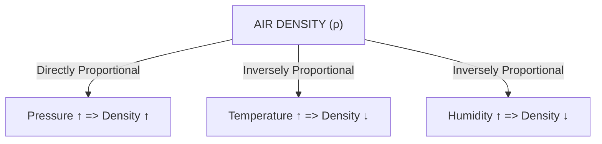
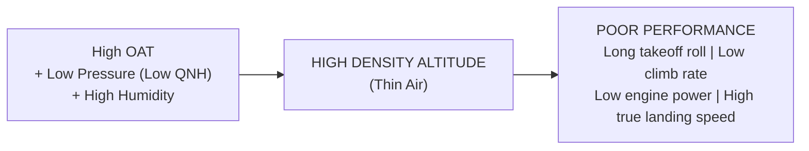

# Chapter 04: Air Density & Aircraft Performance

> **DGCA Syllabus:** Definition of air density, relationship between pressure, temperature, and density (Ideal Gas Law), influence of humidity on air density, Density Altitude (calculation and significance), impact on engine performance, takeoff/landing distance, and rate of climb.  
> **Primary References:** IC Joshi Chapter 4; Oxford/Nordian Chapter 2.4; Volare Question Bank.

---

## 🚀 1. Keyword Core Concepts

- **Air Density ($\rho$):** Mass of air per unit volume ($\text{kg/m}^3$ or $\text{lb/ft}^3$).
  - ISA Sea Level Density: $\mathbf{1.225\text{ kg/m}^3}$ ($0.0765\text{ lb/ft}^3$).
- **The Equation of State (Ideal Gas Law):**
  $$\mathbf{P = \rho R T \implies \rho = \frac{P}{R T}}$$
  - $\rho$ is **directly proportional** to Pressure ($P$).
  - $\rho$ is **inversely proportional** to Absolute Temperature ($T$ in Kelvin).
- **The Humidity Paradox (DGCA Exam Favorite!):**
  - **Moist air is LESS DENSE than dry air at the same pressure and temperature!**
  - *Why?* Molecular weight of water vapour ($H_2O$) is **$18\text{ g/mol}$**, whereas dry air (mostly $N_2$ and $O_2$) has an average molecular weight of **$28.96\text{ g/mol}$**. When water vapour enters a parcel of air, it displaces heavier nitrogen and oxygen molecules!

---

## 📐 2. Density Altitude: Concept & Calculations

- **Definition:** The altitude in the standard atmosphere (ISA) at which the air density is equal to the current air density of the actual atmosphere.
- **In simple terms:** It is the altitude that the aircraft "feels" it is flying at!
- **High Density Altitude = LOW Air Density = Thin Air!**

### Formulas:
$$\mathbf{\text{Pressure Altitude (PA)} = \text{Elevation} + [(1013.25 - \text{QNH}) \times 30]}$$
$$\mathbf{\text{Density Altitude (DA)} = \text{PA} + [120 \times (\text{OAT} - T_{\text{ISA}})]}$$

### Step-by-Step Solved Problem:
> **Question:** An airfield has an elevation of $4,000\text{ ft}$, QNH is $998\text{ hPa}$, and the current ambient temperature (OAT) is $+30^\circ\text{C}$. Calculate the Density Altitude.  
> 
> **Step 1: Calculate Pressure Altitude (PA)**  
> $\text{PA} = 4,000 + (1013 - 998) \times 30 = 4,000 + (15 \times 30) = \mathbf{4,450\text{ ft}}$  
> 
> **Step 2: Calculate ISA Temperature at PA**  
> $T_{\text{ISA}} = 15^\circ\text{C} - (2 \times 4.45) = 15 - 8.9 = \mathbf{+6.1^\circ\text{C}}$  
> 
> **Step 3: Calculate ISA Deviation ($\Delta \text{ISA}$)**  
> $\Delta \text{ISA} = \text{OAT} - T_{\text{ISA}} = 30 - 6.1 = \mathbf{+23.9^\circ\text{C}}$ (ISA $+24$)  
> 
> **Step 4: Calculate Density Altitude (DA)**  
> $\text{DA} = 4,450 + (120 \times 23.9) = 4,450 + 2,868 = \mathbf{7,318\text{ ft}}$  
> *Result:* Even though the physical airfield is at $4,000\text{ ft}$, the aircraft will perform as if it were taking off from a high-altitude runway at **$7,318\text{ ft}$**!

---

## ✈️ 3. Aerodynamic & Operational Impact of Low Air Density

1. **Thrust & Power Output:**
   - Naturally aspirated piston engines suffer loss of power because less oxygen mass enters the cylinders per intake stroke.
   - Jet engines suffer reduced thrust due to reduced mass flow rate through the compressor and turbines.
2. **True Airspeed (TAS) vs Indicated Airspeed (IAS):**
   - The pitot tube measures dynamic pressure: $q = \frac{1}{2} \rho V_{\text{TAS}}^2$.
   - At lower density ($\rho$), the aircraft must fly at a **higher True Airspeed (TAS)** to generate the same dynamic pressure and lift (same IAS).
   - *Rule of Thumb:* TAS increases by approximately **$1.75\%\text{ to }2\%$ per $1,000\text{ ft}$** of altitude for a constant IAS.
3. **Takeoff & Landing Distances:**
   - Because stall speed and liftoff speed occur at a fixed IAS, the aircraft must reach a much higher ground speed to become airborne.
   - Combined with reduced engine acceleration, takeoff distance can double or triple on a hot, high, and humid day!

---

## ⚠️ 4. DGCA Trap Points

1. ⚠️ **"Hot, High, and Humid" $\to$ Triple Threat!**  
   All three factors combine to create maximum density altitude and worst performance.
2. ⚠️ **Altimeter vs Air Density:**  
   The pressure altimeter DOES NOT sense air density; it only senses static pressure! An altimeter set to 1013 will read Pressure Altitude, not Density Altitude.

---

## 📝 5. Practice Exam Questions

#### Q1 (Ref #409): Air density is highest when:
- **A:** Pressure is high, temperature is low, and humidity is low.
- **B:** Pressure is low, temperature is high, and humidity is high.
- **C:** Pressure is high, temperature is high, and humidity is high.
- **D:** Altitude is high, temperature is high, and air is dry.

<b>View Answer</b>

<b>Correct Answer: Option A</b> (Cold, dry, high-pressure air is the densest possible air).

#### Q2: What effect does high humidity have on aircraft takeoff performance?
- **A:** Decreases takeoff distance because moisture lubricates the wings.
- **B:** Increases takeoff distance because moist air is less dense, reducing engine power and wing lift.
- **C:** Has no effect because air density depends solely on temperature.
- **D:** Increases rate of climb due to latent heat release in the boundary layer.

<b>View Answer</b>

<b>Correct Answer: Option B</b>.

