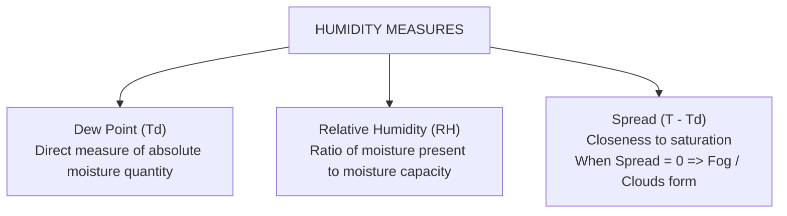
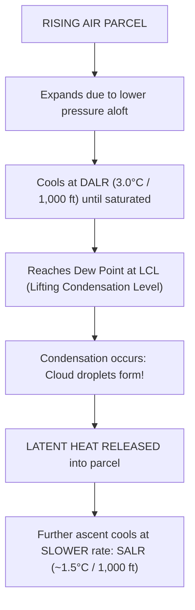

# Chapter 05: Humidity & Adiabatic Processes

> **DGCA Syllabus:** Water vapour in the atmosphere, saturation, vapour pressure, Dew Point ($T_d$), Relative Humidity (RH), mixing ratio, wet-bulb temperature, adiabatic expansion and cooling, Dry Adiabatic Lapse Rate (DALR), Saturated Adiabatic Lapse Rate (SALR), Lifting Condensation Level (LCL).  
> **Primary References:** IC Joshi Chapter 5; Oxford/Nordian Chapter 4; Air Meteorology Notes Page 1-2; Volare Question Bank.

---

## 🚀 1. Keyword Core Concepts

- **Water Vapour:** Invisible gas in the atmosphere, ranging from $0\%$ (cold dry polar regions) to $4\%$ (warm tropical oceans).
- **Vapour Pressure ($e$):** Partial pressure exerted by water vapour molecules alone (hPa).
- **Saturation Vapour Pressure ($e_s$):** Maximum vapour pressure possible at a given temperature.
  - Increases exponentially with temperature: **Warm air can hold significantly more water vapour than cold air!**
- **Dew Point Temperature ($T_d$):** The temperature to which moist air must be cooled at constant pressure to become saturated.
  - Higher dew point $\implies$ Greater moisture content.
  - When Air Temperature ($T$) = Dew Point ($T_d$) $\implies \mathbf{\text{Relative Humidity} = 100\%}$ (Condensation begins $\to$ Fog or Cloud!).
- **Depression of the Dew Point (Spread):**
  $$\mathbf{\text{Spread} = T - T_d}$$
  - A small spread ($0-2^\circ\text{C}$) indicates high humidity and imminent fog or low cloud.
- **Relative Humidity (RH):**
  $$\mathbf{\text{RH} = \frac{\text{Actual Vapour Pressure } (e)}{\text{Saturation Vapour Pressure } (e_s)} \times 100\% \approx \frac{\text{Actual Mixing Ratio } (w)}{\text{Saturation Mixing Ratio } (w_s)} \times 100\%}$$

---

## 🌡️ 2. Measurement: Wet & Dry Bulb Psychrometer

- **Dry-Bulb Thermometer:** Measures actual ambient air temperature ($T$).
- **Wet-Bulb Thermometer:** Bulb enclosed in a wet muslin wick exposed to airflow.
  - Evaporation cools the bulb.
  - In dry air: Rapid evaporation $\implies$ Large wet-bulb depression ($T - T_w$).
  - In saturated air ($\text{RH} = 100\%$): No evaporation $\implies \mathbf{T = T_w = T_d}$.

---

## 🔄 3. Adiabatic Processes & Lapse Rates

An **adiabatic process** is a thermodynamic change of state taking place **without any heat transfer** into or out of the parcel of air.
- Rising air expands due to lower ambient pressure aloft $\implies$ Does work on surrounding air $\implies$ **Cools adiabatically**.
- Sinking air is compressed by higher ambient pressure $\implies$ Work done on the parcel $\implies$ **Warms adiabatically**.

### Lapse Rate Comparison:
| Type | Value in Imperial | Value in Metric | Constancy | Description |
| :--- | :--- | :--- | :--- | :--- |
| **DALR (Dry Adiabatic)** | **$3.0^\circ\text{C} / 1,000\text{ ft}$** | **$0.98^\circ\text{C} / 100\text{ m} \approx 10^\circ\text{C}/\text{km}$** | **Constant** | Applies to unsaturated air ($\text{RH} < 100\%$). |
| **SALR (Saturated Adiabatic)**| **$\approx 1.5^\circ\text{C} / 1,000\text{ ft}$** | **$\approx 5^\circ\text{C}\text{ to }6^\circ\text{C} / \text{km}$** | **Variable!** | Applies once air saturates. Slower cooling because latent heat of condensation is released. |
| **ELR (Environmental)** | Variable | Variable | Variable | Actual ambient temperature profile measured by radiosonde balloon. |

> **Key Rule:** SALR is always **less than** DALR because latent heat released during condensation offsets the expansion cooling!  
> In very cold air (e.g., upper troposphere, $-40^\circ\text{C}$), very little water vapour can condense, so SALR approaches DALR.

---

## ☁️ 4. Convective Cloud Base (LCL) Calculation

When an unsaturated surface parcel is lifted convective heating:
- Temperature cools at the DALR: **$3.0^\circ\text{C} / 1,000\text{ ft}$**.
- Dew Point cools at the Dew Point Lapse Rate: **$\approx 0.5^\circ\text{C} / 1,000\text{ ft}$**.
- Net rate of convergence (Spread closure): $3.0 - 0.5 = \mathbf{2.5^\circ\text{C} / 1,000\text{ ft}}$.

$$\mathbf{\text{Cloud Base (ft AGL)} = \frac{T_{\text{surface}} - T_{d\text{ (surface)}}}{2.5} \times 1,000 = 400 \times (T - T_d)}$$

---

## 📝 5. Practice Exam Questions

#### Q1 (Ref #260): The dry adiabatic lapse rate has a value of:
- **A:** 2°C / 1,000 ft
- **B:** 1.5°C / 1,000 ft
- **C:** 3°C / 1,000 ft
- **D:** 0.65°C / 100 m

<b>View Answer</b>

<b>Correct Answer: Option C</b> ($3.0^\circ\text{C} / 1,000\text{ ft}$ or $\approx 10^\circ\text{C}/\text{km}$).

#### Q2 (Ref #312): Why is the saturated adiabatic lapse rate (SALR) less than the dry adiabatic lapse rate (DALR)?
- **A:** Because moist air is denser than dry air.
- **B:** Because of the release of latent heat of condensation during ascent.
- **C:** Because solar radiation heats saturated air parcels.
- **D:** Because the pressure lapse rate decreases inside clouds.

<b>View Answer</b>

<b>Correct Answer: Option B</b>.

