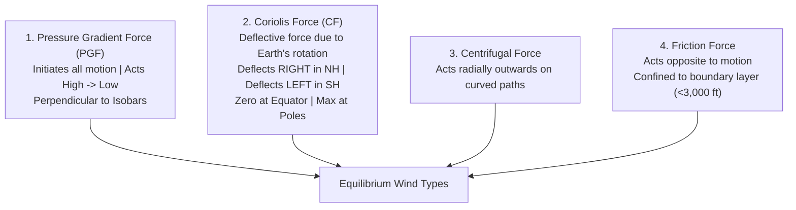
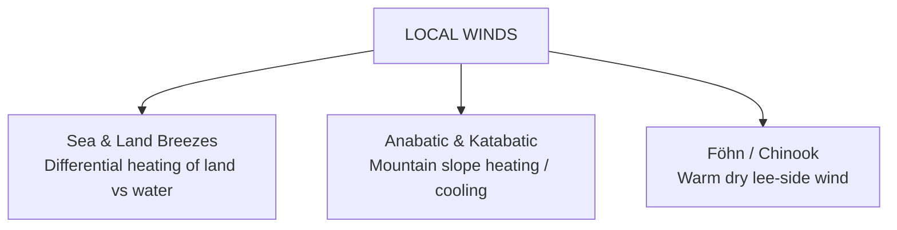

# Chapter 06: Winds & Circulation Dynamics

> **DGCA Syllabus:** Forces acting on horizontal airflow (PGF, Coriolis, Centrifugal, Friction), Geostrophic wind, Gradient wind, Cyclostrophic wind, Buys Ballot's Law, Veering and Backing, Diurnal variation of surface wind, Local winds (Sea/Land Breeze, Anabatic/Katabatic winds, Föhn/Chinook wind, Mountain winds).  
> **Primary References:** IC Joshi Chapter 6; Oxford/Nordian Chapter 6; Volare Question Bank.

---

## 🚀 1. Keyword Core Concepts

- **Wind:** Horizontal motion of air relative to the Earth's surface (vertical motion is termed *current* or *updraft/downdraft*).
- **Wind Direction:** The direction **FROM WHICH** the wind blows (e.g., wind from $270^\circ$ is a Westerly wind).
  - *Tower / ATC Reports:* Given in **Degrees Magnetic** (aligned with runway heading).
  - *METAR / TAF / Met Charts:* Given in **Degrees True**!
  - *Memory Rule:* **"If you read it, it's True; if you hear it, it's Magnetic!"**
- **Veering vs Backing:**
  - **Veering:** Clockwise change in wind direction (e.g., $090^\circ \to 120^\circ$).
  - **Backing:** Counter-clockwise change in wind direction (e.g., $120^\circ \to 090^\circ$).
- **Gale:** Sustained wind speed of $\ge 34\text{ kt}$ (Beaufort Force 8).
- **Squall:** Sudden abrupt increase in wind speed by at least **$16\text{ kt}$**, reaching **$\ge 22\text{ kt}$**, and lasting for at least **1 minute**.
- **Gust:** Brief, sharp increase in wind speed lasting only a few seconds.

---

## ⚖️ 2. The 4 Forces Governing Horizontal Wind

### Wind Equilibrium Types:
1. **Geostrophic Wind ($V_g$):**
   - Equilibrium between **PGF** and **Coriolis Force**.
   - Valid for **straight, parallel isobars** in the **free atmosphere** (above friction layer, $>3,000\text{ ft}$).
   - Blows strictly parallel to isobars.
   - Formula: $\mathbf{V_g = \frac{1}{2 \rho \Omega \sin\phi} \frac{\Delta P}{\Delta n}}$.
   - Strongest at **low latitudes** (small $\sin\phi$) and in **low air density** for a given pressure gradient.
2. **Gradient Wind ($V_{\text{grad}}$):**
   - Equilibrium between **PGF, Coriolis Force, and Centrifugal Force** along **curved isobars**.
   - **Anticyclone (High):** Centrifugal force aids PGF $\implies \mathbf{V_{\text{grad}} > V_g}$ (**Supergeostrophic**).
   - **Cyclone (Low):** Centrifugal force opposes PGF $\implies \mathbf{V_{\text{grad}} < V_g}$ (**Subgeostrophic**).
3. **Cyclostrophic Wind:**
   - Balance between **PGF** and **Centrifugal Force** alone (Coriolis force is negligible).
   - Occurs in tight, intense vortices near the equator or on small scales: **Tornadoes, Waterspouts, Dust Devils**.

---

## 🧭 3. Buys Ballot's Law

> **In the Northern Hemisphere:** Stand with your back to the wind $\implies$ **Low pressure is on your LEFT**, and High pressure is on your RIGHT!  
> *(In the Southern Hemisphere: Low is on your RIGHT).*

---

## 📈 4. Wind Changes with Altitude & Diurnal Variation

### Climb from Surface to Free Atmosphere (Northern Hemisphere):
- Below $2,000-3,000\text{ ft}$, surface friction slows the wind down.
- Slower wind $\implies$ Weaker Coriolis force $\implies$ PGF pulls wind across isobars toward low pressure.
- As an aircraft **climbs out of the friction layer**:
  - Wind speed **increases** ($2\times$ over land).
  - Wind **VEERS** (turns clockwise by $\approx 30^\circ$ over land, $\approx 10^\circ$ over sea).
- As an aircraft **descends into the friction layer**:
  - Wind speed **decreases**.
  - Wind **BACKS** (turns counter-clockwise) and crosses isobars at $\approx 30^\circ$ toward Low pressure.

### Diurnal Variation of Surface Wind:
- **By Day:** Solar heating triggers thermal convection, mixing high-momentum air from aloft down to the surface $\implies$ Surface wind **veers and increases in speed with gusts**.
- **By Night:** Ground cools, inversion forms, decouples surface from upper winds $\implies$ Surface wind **backs and decreases to calm or light**.

---

## 🌊 5. Local Wind Systems

### 1. Sea Breeze vs Land Breeze:
| Feature | Sea Breeze | Land Breeze |
| :--- | :--- | :--- |
| **Timing** | Daytime (maximum $14:00 - 15:00$ local) | Nighttime (around dawn / sunrise) |
| **Flow Direction** | **From Sea to Land** | **From Land to Sea** |
| **Mechanism** | Land heats faster than sea $\to$ thermal low over land | Land cools faster than sea $\to$ shallow high over land |
| **Speed & Extent**| $10-20\text{ kt}$, extends $15-30\text{ NM}$ inland | Lighter ($5-10\text{ kt}$), extends only $5-10\text{ NM}$ offshore |

### 2. Anabatic vs Katabatic Winds:
- **Anabatic Wind (Upslope):** Daytime solar heating warms mountain slopes faster than valley air; warm air rises **upslope**. Lighter ($5-10\text{ kt}$).
- **Katabatic Wind (Drainage / Downslope):** Nighttime radiative cooling chills dense air on high plateaus/glaciers; gravity drains cold heavy air **down into valleys**. Can be violently fast ($>50\text{ kt}$ in Greenland/Antarctica, e.g., Mistral, Bora).

### 3. The Föhn / Chinook Wind:
- A warm, dry wind that blows down the **leeward side** of a mountain range.
- **Thermodynamic Cycle:**
  1. Moist air ascends windward slope $\implies$ Cools at **DALR** ($3^\circ\text{C}/1000\text{ ft}$) until saturation $\implies$ Cools at **SALR** ($\approx 1.5^\circ\text{C}/1000\text{ ft}$) with heavy rain/snow.
  2. Moisture is stripped out at the summit.
  3. Air descends leeward slope dry $\implies$ Warms at the rapid **DALR** ($3^\circ\text{C}/1000\text{ ft}$) the entire way down!
  4. **Result:** Leeward air arrives drastically **WARMER and DRIER** than it started!

---

## 📝 6. Practice Exam Questions (From Question Bank)

#### Q1 (Ref #268): In the Northern Hemisphere, if an aircraft flies toward an area of low pressure, the crosswind experienced will be:
- **A:** From the left (Port drift).
- **B:** From the right (Starboard drift).
- **C:** Headwind.
- **D:** Tailwind.

<b>View Answer</b>

<b>Correct Answer: Option B (From the right)</b>  
<i>Explanation:</i> By Buys Ballot's Law, when heading directly toward the Low, the Low is ahead; wind blows counter-clockwise around Lows in NH, crossing from right to left across track.

#### Q2 (Ref #315): In the Northern Hemisphere, as an aircraft climbs through the planetary friction layer (1,000 to 3,000 ft), the wind typically:
- **A:** Backs and decreases in speed.
- **B:** Veers and increases in speed.
- **C:** Backs and increases in speed.
- **D:** Veers and decreases in speed.

<b>View Answer</b>

<b>Correct Answer: Option B (Veers and increases in speed)</b>.

#### Q3 (Ref #273): In the central part of the Atlantic Ocean between 10°N and 20°N, the prevailing winds are:
- **A:** NE trade winds.
- **B:** SE trade winds.
- **C:** Westerly winds.
- **D:** Polar easterlies.

<b>View Answer</b>

<b>Correct Answer: Option A (NE trade winds)</b>.

