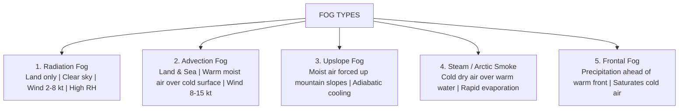

# Chapter 07: Visibility, Fog, Mist & Haze

> **DGCA Syllabus:** Definitions of visibility, Meteorological Optical Range (MOR), Runway Visual Range (RVR), Slant vs Vertical visibility, distinction between Fog, Mist, Haze, and Smoke, types of Fog (Radiation, Advection, Upslope, Steam, Frontal), formation conditions, dissipation, and operational flight hazards.  
> **Primary References:** IC Joshi Chapter 7; Oxford/Nordian Chapter 8; Volare Question Bank.

---

## 🚀 1. Keyword Core Concepts

- **Visibility (Meteorological):** The greatest horizontal distance at which a black object of suitable dimensions can be seen and recognized against the horizon sky by normal day vision.
- **Runway Visual Range (RVR):** The range over which the pilot of an aircraft on the centreline of a runway can see the runway surface markings or the lights delineating the runway or identifying its centreline.
  - Measured automatically by **Transmissometers** or **Forward-Scatter Meters**.
  - Reported in METAR when visibility or RVR is **$< 1,500\text{ m}$**.
- **Slant Visibility vs Vertical Visibility:**
  - **Slant Visibility:** Pilot's line-of-sight visibility looking diagonally from the cockpit down toward the approach lights.  
    *Critical Hazard:* In shallow radiation fog, looking straight down from overhead, runway lights may be visible (good vertical visibility), but on 3-degree glide slope (slant path), the aircraft enters dense fog and visual references vanish!
  - **Vertical Visibility (`VV`):** Maximum vertical distance into an obscuring layer (such as fog or snow) from which ground-based objects are visible.

---

## 🌫️ 2. The Great Obscuration Comparison Table

| Phenomenon | METAR Code | Visibility Limit | Relative Humidity (RH) | Particle Nature |
| :--- | :--- | :--- | :--- | :--- |
| **Fog** | **`FG`** | **$< 1,000\text{ m}$** | **$\approx 100\%$** (usually $\ge 95\%$) | Microscopic liquid water droplets (or ice crystals) suspended in air. |
| **Mist** | **`BR`** | **$1,000\text{ m to }5,000\text{ m}$** | **$\ge 95\%$** | Liquid water droplets; feels damp; grayish appearance. |
| **Haze** | **`HZ`** | **$\le 5,000\text{ m}$** | **$< 95\%$** (usually $< 80\%$) | Extremely fine dry particles (dust, salt, pollution); opalescent blue against dark ground, yellowish against sun. |
| **Smoke** | **`FU`** | Variable | Any | Suspended combustion particles; distinct odor; sun appears red. |

---

## 🏭 3. The 5 Major Fog Types: Complete Comparative Matrix

### Comparative Detailed Breakdown:
| Fog Type | Critical Formation Conditions | Location | Wind Requirement | Dissipation Factors |
| :--- | :--- | :--- | :--- | :--- |
| **Radiation Fog** | Clear night, long winter night, high RH, radiative cooling | **Land ONLY** (Never over open sea due to negligible diurnal SST variation) | **Light breeze: $2\text{ to }8\text{ kt}$** *(Calm gives dew/frost; $>10\text{ kt}$ gives low stratus)* | Solar insolation (surface heating) or wind speed $>10\text{ kt}$ |
| **Advection Fog** | Warm, moist air blowing horizontally over a cold surface | **Sea and Coastal Land** (can blow inland) | **Moderate: $8\text{ to }15\text{ kt}$** (Persistent even with strong winds!) | Change of air mass or wind direction away from cold surface |
| **Upslope Fog** | Stable moist air forced up terrain by wind, cooling adiabatically | Windward mountain slopes and elevated plateaus | **Moderate upslope wind: $10-20\text{ kt}$** | Wind cessation or wind shift to downslope (leeward) |
| **Steam Fog (Arctic Smoke)**| Frigid polar air moving over warm water; intense evaporation | Polar waters, ice-free lakes in winter | Light to moderate | Warming of cold air mass |
| **Frontal Fog** | Rain falling from warm air aloft evaporates into cold stable surface air | Ahead of **Warm Front** or along cold front | Variable | Passage of the frontal boundary |

---

## ⚠️ 4. DGCA Trap Points & Memory Mnemonics

1. ⚠️ **Radiation Fog NEVER forms at sea:**  
   The diurnal variation of sea surface temperature is $<1^\circ\text{C}$, which is insufficient to trigger radiative cooling to dew point.
2. ⚠️ **The Wind Sweet Spot for Radiation Fog:**  
   - $\text{Calm } (<2\text{ kt}) \implies$ Only Dew or Frost forms (no vertical mixing).
   - $\mathbf{2\text{ to }8\text{ kt}} \implies$ **Ideal Radiation Fog** (slight turbulence mixes cold layer through 100-500 ft).
   - $>10\text{ kt} \implies$ Stratus cloud deck forms instead of fog!
3. ⚠️ **Advection Fog can persist in daylight:**  
   Unlike radiation fog, advection fog does NOT burn off under the midday sun because the underlying cold surface keeps cooling the air continuously.

---

## 📝 5. Practice Exam Questions (From Question Bank)

#### Q1 (Ref #275): Which conditions are most favorable for the formation of radiation fog?
- **A:** Strong winds, overcast clouds, and afternoon sunshine.
- **B:** High relative humidity, clear skies, and light breeze of 2 to 8 knots on a long winter night.
- **C:** Gale force winds over a warm ocean current.
- **D:** Rapid passage of a fast-moving cold front.

<b>View Answer</b>

<b>Correct Answer: Option B</b>.

#### Q2 (Ref #316): How does advection fog differ fundamentally from radiation fog?
- **A:** Advection fog only forms in mountainous areas.
- **B:** Advection fog requires calm air and occurs exclusively in summer.
- **C:** Advection fog forms when warm moist air moves over a colder surface and can form over both sea and land day or night.
- **D:** Advection fog burns off rapidly 30 minutes after sunrise.

<b>View Answer</b>

<b>Correct Answer: Option C</b>.

