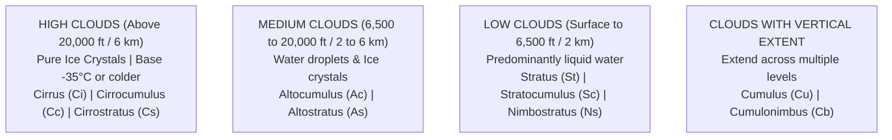
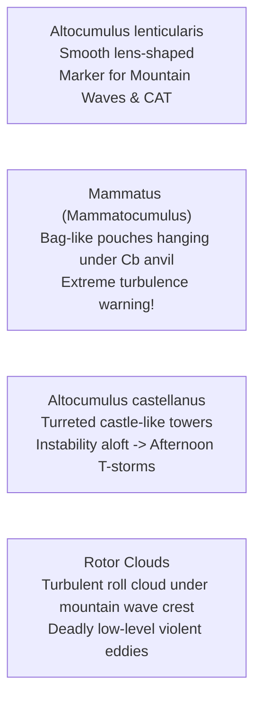

# Chapter 08: Clouds & Vertical Motion

> **DGCA Syllabus:** Cloud formation mechanisms (convection, orography, frontal lift, turbulence), the 10 basic Cloud Genera, cloud classification by height, special cloud forms (Lenticular, Rotor, Castellanus, Mammatus), Cloud Ceiling vs Cloud Base, reporting coverage in oktas.  
> **Primary References:** IC Joshi Chapter 8; Oxford/Nordian Chapter 8; Volare Question Bank.

---

## 🚀 1. Keyword Core Concepts

- **Cloud:** Visible aggregate of minute water droplets, ice crystals, or a mixture of both, suspended in free air.
- **Condensation Nuclei (Aerosols):** Microscopic hygroscopic particles (salt, dust, combustion soot) essential for water vapour to condense upon.
- **Vertical Motion Mechanisms:**
  1. **Thermal Convection:** Solar heating creates rising thermals $\implies$ Cumuliform clouds ($\text{Cu, Cb}$).
  2. **Orographic Lifting:** Wind forced upward by mountains $\implies$ Cap clouds, Lenticular clouds, banner clouds.
  3. **Frontal Uplift:** Warm air sliding up a cold air wedge $\implies$ Extensive stratiform decks ($\text{Cs, As, Ns}$).
  4. **Turbulence Mixing:** Surface friction mixing moist air in the boundary layer $\implies$ Stratocumulus ($\text{Sc}$).

---

## ☁️ 2. The 10 Basic Cloud Genera (By Altitude Levels)

### Complete Classification Matrix:
| Genera | Code | Altitude Level | Physical Composition | Key Aviation Features & DGCA Exam Points |
| :--- | :--- | :--- | :--- | :--- |
| **Cirrus** | `Ci` | High ($>20,000\text{ ft}$) | Ice crystals | Detached, white, delicate fibrous filaments or mares' tails. No icing hazard. |
| **Cirrocumulus**| `Cc` | High ($>20,000\text{ ft}$) | Ice crystals | Small white rippled flakes or patches ("mackerel sky"). Rare. |
| **Cirrostratus** | `Cs` | High ($>20,000\text{ ft}$) | Ice crystals | Transparent whitish veil. **Produces Solar & Lunar HALOS ($22^\circ\text{ & }46^\circ$)!** Precursor to warm front. |
| **Altocumulus** | `Ac` | Medium ($6,500-20,000\text{ ft}$) | Supercooled water & ice | White/grey sheets of rolls or rounded masses. **Produces CORONAS!** `Ac castellanus` indicates instability aloft and potential thunderstorms! |
| **Altostratus** | `As` | Medium ($6,500-20,000\text{ ft}$) | Supercooled water & ice | Striated grey/bluish sheet. Sun visible as through ground glass ("watery sun"). **NO halos!** Moderate icing hazard. |
| **Nimbostratus** | `Ns` | Low / Medium ($1,000-10,000\text{ ft}$) | Water droplets, raindrops, snow | Dark, thick, amorphous grey layer. **Continuous steady rain or snow.** Severe icing hazard! |
| **Stratocumulus**| `Sc` | Low ($1,000-6,500\text{ ft}$) | Liquid water | Grey or whitish patches/sheets of rolls. Most common cloud in the world. Mild turbulence. |
| **Stratus** | `St` | Low (Surface to $1,500\text{ ft}$) | Liquid water | Uniform grey cloud deck resembling elevated fog. **Produces DRIZZLE (`DZ`).** Low base creates serious landing minimum hazards. |
| **Cumulus** | `Cu` | Vertical ($2,000-15,000\text{ ft}$) | Liquid water (ice at top) | Detached, dense mounds with sharp outlines, flat dark base, dome-shaped bubbling top ("cotton wool"). |
| **Cumulonimbus**| `Cb` | Great Vertical ($1,000\text{ to }>45,000\text{ ft}$) | Water droplets, supercooled drops, hail, ice | **The Aviator's Nemesis!** Heavy anvil head (`incus`), severe turbulence, microbursts, lightning, heavy icing, large hail. |

---

## 🌪️ 3. Special Cloud Species of Critical Aviation Importance

---

## 📏 4. Cloud Amount & Cloud Ceiling Definition

### Cloud Amount (Oktas of Sky Covered):
- **`FEW`:** $1\text{ to }2\text{ oktas}$ (Trace to $25\%$).
- **`SCT` (Scattered):** $3\text{ to }4\text{ oktas}$ ($37\%\text{ to }50\%$).
- **`BKN` (Broken):** $5\text{ to }7\text{ oktas}$ ($62\%\text{ to }87\%$).
- **`OVC` (Overcast):** $8\text{ oktas}$ ($100\%$ full cover).

### The Golden Definition of Cloud Ceiling:
> **Cloud Ceiling:** The height above ground or water (AGL) of the base of the lowest layer of cloud that covers **more than half the sky** (i.e., **`BKN` (5-7 oktas)** or **`OVC` (8 oktas)**), or the vertical visibility in an obscured sky.  
> *(Note: `FEW` and `SCT` layers DO NOT constitute a ceiling!)*

---

## 📝 5. Practice Exam Questions (From Question Bank)

#### Q1 (Ref #283): Halos around the sun or moon are produced by which cloud type?
- **A:** Altostratus
- **B:** Cirrostratus
- **C:** Stratocumulus
- **D:** Nimbostratus

<b>View Answer</b>

<b>Correct Answer: Option B (Cirrostratus)</b>  
<i>Explanation:</i> Halos are formed by refraction of light through hexagonal ice crystals found in thin Cirrostratus sheets. (Altostratus produces a watery sun without halos; Altocumulus produces coronas through diffraction).

#### Q2 (Ref #328): Which cloud is capable of producing continuous steady rain or snow?
- **A:** Nimbostratus
- **B:** Cirrus
- **C:** Altocumulus castellanus
- **D:** Cumulus humilis

<b>View Answer</b>

<b>Correct Answer: Option A (Nimbostratus)</b>.

#### Q3 (Ref #345): The presence of Altocumulus lenticularis clouds is a positive visual warning of:
- **A:** Severe ground fog.
- **B:** Standing mountain waves and severe turbulence.
- **C:** Rapidly falling barometric pressure at sea.
- **D:** Approaching tropical hurricane.

<b>View Answer</b>

<b>Correct Answer: Option B</b>.

