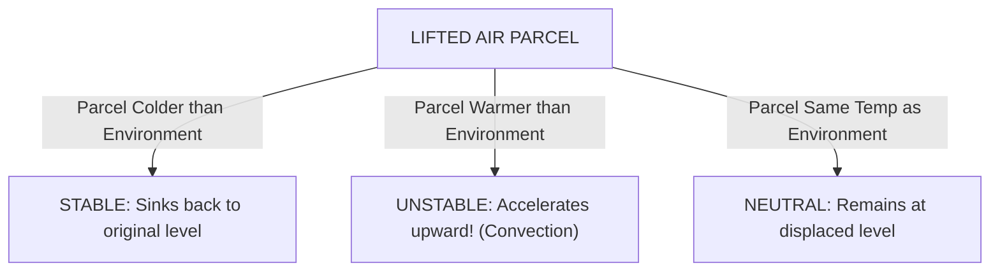
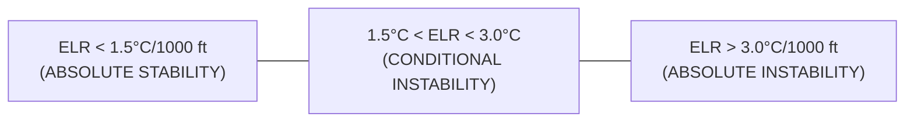

# Chapter 09: Atmospheric Stability & Lapse Rates

> **DGCA Syllabus:** Atmospheric equilibrium (stable, unstable, neutral), comparison of Environmental Lapse Rate (ELR) with DALR and SALR, Absolute Stability, Absolute Instability, Conditional Instability, Latent Instability, convective condensation level, flight weather characteristics in stable vs unstable atmospheres.  
> **Primary References:** IC Joshi Chapter 9; Oxford/Nordian Chapter 4; Volare Question Bank.

---

## 🚀 1. Keyword Core Concepts

- **Atmospheric Stability:** The tendency of an air parcel displaced vertically to return to its original level (stable), accelerate away from its original level (unstable), or remain at its new displaced level (neutral).
- **The Core Rule of Buoyancy:**
  - If a lifted parcel is **COLDER** (denser) than the ambient environment $\implies$ It sinks back $\implies$ **STABLE**.
  - If a lifted parcel is **WARMER** (lighter) than the ambient environment $\implies$ It continues to rise $\implies$ **UNSTABLE**.
  - If a lifted parcel is the **SAME TEMPERATURE** as the ambient environment $\implies$ **NEUTRAL**.

---

## 📊 2. The 3 Stability States: Mathematical Criteria

The state of stability is determined solely by comparing the **Environmental Lapse Rate (ELR)** with the **Dry Adiabatic Lapse Rate (DALR = $3.0^\circ\text{C}/1000\text{ ft}$)** and the **Saturated Adiabatic Lapse Rate (SALR $\approx 1.5^\circ\text{C}/1000\text{ ft}$)**.

### Complete Criteria Table:
| Stability State | Lapse Rate Condition | Behavior if Unsaturated (Dry) | Behavior if Saturated (Wet) | Associated Weather |
| :--- | :--- | :--- | :--- | :--- |
| **Absolute Stability** | $\mathbf{\text{ELR} < \text{SALR} < \text{DALR}}$ ($\text{ELR} < 1.5^\circ\text{C}/1000\text{ ft}$) | Stable (sinks back) | Stable (sinks back) | Stratus clouds, fog, smooth air, poor visibility, haze/smog |
| **Absolute Instability** | $\mathbf{\text{ELR} > \text{DALR} > \text{SALR}}$ ($\text{ELR} > 3.0^\circ\text{C}/1000\text{ ft}$) | **Unstable (rises)** | **Unstable (rises)** | Vigorous convection, Cumulus, Cb, severe turbulence, gusty winds |
| **Conditional Instability**| $\mathbf{\text{SALR} < \text{ELR} < \text{DALR}}$ ($1.5^\circ\text{C} < \text{ELR} < 3.0^\circ\text{C}/1000\text{ ft}$) | **STABLE** if unsaturated | **UNSTABLE** if saturated! | Stable until lifted to condensation level (LCL); once clouds form, latent heat triggers rapid instability! |
| **Neutral Equilibrium (Dry)** | $\mathbf{\text{ELR} = \text{DALR}}$ ($3.0^\circ\text{C}/1000\text{ ft}$) | Neutral | Unstable | Well-mixed boundary layer |
| **Neutral Equilibrium (Saturated)**| $\mathbf{\text{ELR} = \text{SALR}}$ ($\approx 1.5^\circ\text{C}/1000\text{ ft}$) | Stable | Neutral | Overcast nimbostratus |
| **Temperature Inversion** | $\mathbf{\text{ELR} < 0}$ (Temp rises with height)| Extremely Stable | Extremely Stable | Traps pollutants, ground fog, severe low-level windshear |

---

## ✈️ 3. Flying Weather: Stable Air vs Unstable Air

This is one of the most heavily tested comparative themes in DGCA exams:

| Weather Element | Stable Atmosphere | Unstable Atmosphere |
| :--- | :--- | :--- |
| **Cloud Type** | **Stratiform** (St, Sc, As, Ns) or cloudless | **Cumuliform** (Cu, Cb, TCU) |
| **Airflow / Turbulence** | **Smooth air**, laminar flow, negligible turbulence | **Turbulent**, choppy, strong thermals, updrafts/downdrafts |
| **Visibility** | **Poor** (smoke, haze, mist trapped near surface) | **Good / Excellent** outside showers (active vertical mixing) |
| **Precipitation** | **Continuous**, steady rain or drizzle (`RA`, `DZ`) | **Showers** (`SHRA`), intermittent, sudden onset, hail |
| **Surface Winds** | Steady, calm to light | Gusty, squally, variable direction |
| **Altimeter Hazards** | Temperature inversions create altimeter errors | Severe vertical windshear & microbursts |

---

## ⚠️ 4. DGCA Trap Points

1. ⚠️ **Conditional Instability is the NORMAL state of the Troposphere:**  
   Standard atmosphere lapse rate is $1.98^\circ\text{C}/1000\text{ ft}$, which lies right between SALR ($1.5^\circ\text{C}$) and DALR ($3.0^\circ\text{C}$)!
2. ⚠️ **Superadiabatic Lapse Rate:**  
   When $\text{ELR} > 3.0^\circ\text{C}/1000\text{ ft}$ (Absolute Instability), it is also termed *superadiabatic*. Confined strictly to the lowest few hundred feet over sunbaked desert ground.

---

## 📝 5. Practice Exam Questions (From Question Bank)

#### Q1 (Ref #269): An air mass is said to be conditionally unstable when:
- **A:** The ELR is greater than the DALR.
- **B:** The ELR is less than the SALR.
- **C:** The ELR is between the SALR and the DALR.
- **D:** The ELR is negative.

<b>View Answer</b>

<b>Correct Answer: Option C (ELR between SALR and DALR)</b>  
<i>Explanation:</i> The parcel is stable when dry (displaced at DALR) but becomes buoyant and unstable once saturated (displaced at SALR).

#### Q2 (Ref #334): Which flying conditions are characteristic of a flight through an unstable air mass?
- **A:** Smooth air, stratiform clouds, and poor visibility in haze.
- **B:** Turbulent air, cumuliform clouds, good visibility outside showers, and gusty surface winds.
- **C:** Continuous light drizzle and calm surface winds.
- **D:** Uniform fog and zero vertical air currents.

<b>View Answer</b>

<b>Correct Answer: Option B</b>.

