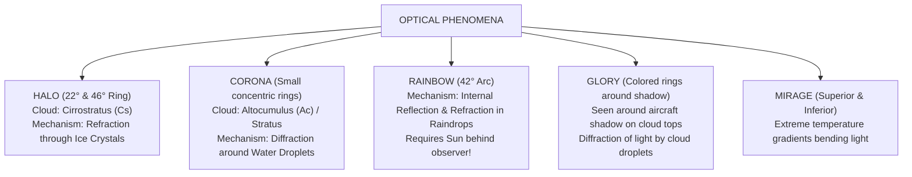

# Chapter 10: Optical & Electrical Phenomena

> **DGCA Syllabus:** Refraction, reflection, and diffraction in the atmosphere, Solar and Lunar Halos, Coronas, Rainbows, Glory (Brocken Spectre), Mirages (Superior vs Inferior), St. Elmo's Fire, static electricity hazards in flight.  
> **Primary References:** IC Joshi Chapter 10; Oxford/Nordian Chapter 8; Volare Question Bank.

---

## 🚀 1. Keyword Core Concepts

- **Atmospheric Optics:** Produced by interaction of sunlight or moonlight with atmospheric particles:
  - **Refraction:** Bending of light rays passing through media of different densities or ice crystal prisms.
  - **Reflection:** Bouncing of light off water droplet or ice crystal surfaces.
  - **Diffraction:** Bending of light waves around the edges of minute liquid water droplets.
  - **Scattering:** Rayleigh scattering by gas molecules (causes blue sky and red sunsets).

---

## 🌈 2. The Optical Phenomena Comparison Matrix

### Complete Optical Summary Table:
| Phenomenon | Required Particle Type | Associated Cloud | Physical Mechanism | Visual Appearance & Exam Points |
| :--- | :--- | :--- | :--- | :--- |
| **Halo** | **Hexagonal Ice Crystals** | **Cirrostratus (`Cs`)** | **Refraction** | Large ring of $22^\circ$ (most common) or $46^\circ$ around Sun or Moon. Red inside, blue outside. **Strong indicator of approaching warm front!** |
| **Corona** | **Minute Water Droplets** | **Altocumulus (`Ac`)** or `Sc` | **Diffraction** | Small series of colored rings closely hugging the Sun or Moon. Blue inside, red outside. |
| **Rainbow** | **Liquid Raindrops** | Shower / Rain area | **Refraction + Internal Reflection** | Arc centered on anti-solar point ($42^\circ$ radius). Primary bow has red on outside, violet inside. Observer must have **Sun behind back**! |
| **Glory** | **Cloud Water Droplets** | Fog or Stratus tops | **Diffraction** | Colored rings seen directly around the shadow of the aircraft projected onto a cloud layer below. |
| **Inferior Mirage**| Hot surface air | None (Clear sunny desert/runway) | **Refraction (Upward bending)** | Looking down at hot ground, light from sky bends upward $\to$ appears like a pool of water on the runway/road. |
| **Superior Mirage**| Strong ground temperature inversion | Cold sea / Arctic surface | **Refraction (Downward bending)** | Looking toward cold horizon, light bends downward $\to$ objects appear elevated or floating in the sky above their true position. |

---

## ⚡ 3. Electrical Phenomena: St. Elmo's Fire & Aircraft Static

- **St. Elmo's Fire:**
  - A luminous, silent electrical brush discharge (corona discharge) emanating from sharp pointed extremities of the aircraft (windshield corners, nose cone, wingtips, propeller tips).
  - Occurs when flying through highly charged atmospheres: **near thunderstorms (`Cb`), in heavy snow, or charged ice crystal clouds**.
  - Emits a ghostly blue-violet or greenish glow, often accompanied by crackling static in aircraft communication radios ("precipitation static" / P-static).
  - *Hazard Level:* Does **not** cause structural damage to the aircraft, but serves as an immediate warning of entering a high-voltage electrostatic field with potential impending **lightning strike**!
- **Static Discharge Wicks:**
  - Trailing edge conductive braided cords that slowly bleed accumulated static charge back into the air stream to prevent radio blackout and spark ignition.

---

## 📝 4. Practice Exam Questions

#### Q1 (Ref #283): Halos around the sun or moon are produced by:
- **A:** Diffraction of light by water droplets in Altocumulus clouds.
- **B:** Refraction of light through hexagonal ice crystals in Cirrostratus clouds.
- **C:** Internal reflection of light in heavy rain showers.
- **D:** Scattering of light by smoke particles in an inversion.

<b>View Answer</b>

<b>Correct Answer: Option B</b>.

#### Q2: What is the primary difference between a Halo and a Corona?
- **A:** Halos are caused by ice crystals in high clouds (refraction), while Coronas are caused by water droplets in medium clouds (diffraction).
- **B:** Halos are small, Coronas are large.
- **C:** Halos only occur at night, Coronas only occur during the day.
- **D:** Halos indicate fair weather, Coronas indicate tornadoes.

<b>View Answer</b>

<b>Correct Answer: Option A</b>.

