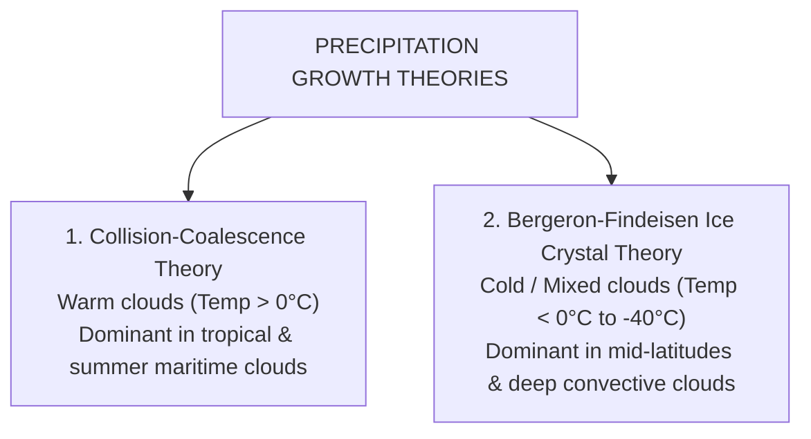

# Chapter 11: Precipitation & Mechanisms

> **DGCA Syllabus:** Physical processes of precipitation formation (Collision-Coalescence and Bergeron-Findeisen processes), Supercooled Liquid Water (SLW), precipitation forms (Rain, Drizzle, Freezing Rain, Snow, Sleet/Ice Pellets, Hail, Graupel), Virga, and associated flight hazards.  
> **Primary References:** IC Joshi Chapter 11; Oxford/Nordian Chapter 9; Volare Question Bank.

---

## 🚀 1. Keyword Core Concepts

- **Precipitation:** Any product of the condensation of atmospheric water vapour that falls under gravity from clouds and reaches the ground.
- **The Raindrop Problem:** Typical cloud droplets have diameters of $\approx 0.02\text{ mm}$ ($20\text{ }\mu\text{m}$) and fall at only $0.01\text{ m/s}$. They evaporate long before hitting the ground. A raindrop ($1-2\text{ mm}$) contains the volume of roughly **one million cloud droplets**!

---

## 🔬 2. The Two Precipitation Growth Mechanisms

### 1. Collision-Coalescence Process (Warm Clouds):
- Operates in clouds where the temperature is entirely above freezing ($>0^\circ\text{C}$).
- Larger hygroscopic droplets have higher terminal fall velocities than smaller droplets.
- As larger droplets fall through the cloud, they collide with and absorb smaller droplets (**coalescence**), sweeping up moisture until they grow heavy enough to fall out as rain.

### 2. The Bergeron-Findeisen Process (Cold / Mixed Clouds - DGCA Favorite!):
- In the temperature zone between **$0^\circ\text{C}\text{ and }-40^\circ\text{C}$**, clouds consist of a mixture of **ice crystals and Supercooled Liquid Water Droplets (SLWD)**.
- **Fundamental Physical Law:** **The Saturation Vapour Pressure over water is GREATER than the Saturation Vapour Pressure over ice!** ($e_{s\text{ (water)}} > e_{s\text{ (ice)}}$).
- **The Consequence:**
  1. The air is simultaneously **undersaturated** relative to liquid water and **supersaturated** relative to ice.
  2. Liquid water droplets continuously evaporate into water vapour.
  3. Water vapour rapidly deposits directly onto the ice crystals by sublimation/deposition.
  4. The ice crystals grow rapidly into large snowflakes at the expense of evaporating water droplets!
  5. As they fall through the freezing level ($0^\circ\text{C}$ isotherm), they melt into raindrops.

---

## 🌧️ 3. Complete Precipitation Classification & METAR Codes

| Precipitation Form | METAR Code | State & Size | Originating Cloud Type | Critical Aviation Flight Hazard |
| :--- | :--- | :--- | :--- | :--- |
| **Drizzle** | **`DZ`** | Liquid droplets **$< 0.5\text{ mm}$** diameter; falls slowly | **Stratus (`St`)** or Fog | Extremely low cloud ceiling and poor visibility. |
| **Rain** | **`RA`** | Liquid drops **$\ge 0.5\text{ mm}$** diameter | **Nimbostratus (`Ns`)** (continuous) or **`As`** | Decreased runway braking friction (aquaplaning / hydroplaning). |
| **Showers** | **`SH`** | Intermittent rain, snow, or hail | **Cumulus (`Cu`)** or **Cumulonimbus (`Cb`)** | Rapidly fluctuating visibility, sudden strong wind shifts. |
| **Freezing Rain** | **`FZRA`** | Supercooled liquid drops freezing instantly on impact | Warm air aloft over cold sub-zero surface wedge | **EXTREME DANGER!** Forms instantaneous heavy Clear / Glaze ice on airframe; can cause aerodynamic stall in minutes! |
| **Snow** | **`SN`** | White ice crystals in hexagonal branched structures | **Nimbostratus (`Ns`)** or `Cb` | Severe reduction in visibility; snow drifts on runway; airframe icing. |
| **Ice Pellets (Sleet)**| **`PL`** | Hard, transparent frozen raindrops ($<5\text{ mm}$) | Rain freezing as it falls through deep cold layer aloft | Positive warning of **Freezing Rain aloft**! |
| **Hail** | **`GR`** | Hard balls of ice **$\ge 5\text{ mm}$** up to $10+\text{ cm}$ | Strictly **Cumulonimbus (`Cb`)** | Severe structural airframe damage, punctured radomes, shattered windshields. |
| **Small Hail / Snow Pellets** | **`GS`** | White, opaque, crisp ice grains ($<5\text{ mm}$) | `Cb` or `TCU` | Runway slippery; moderate turbulence. |

---

## 💨 4. Virga (Fallstreaks): The Invisible Trap

- **Virga:** Precipitation falling from the base of a cloud that completely evaporates in dry sub-cloud air before reaching the ground.
- **Aviation Trap:** Evaporation is an endothermic process (absorbs latent heat from surrounding air).
  - The air column under virga cools rapidly $\implies$ Becomes significantly denser than ambient air $\implies$ Accelerates violently downward.
  - Generates devastating **Dry Microbursts** and low-level windshear with zero visual rain on the runway!

---

## 📝 5. Practice Exam Questions (From Question Bank)

#### Q1 (Ref #266): The Bergeron-Findeisen process explains the growth of precipitation in a cloud due to:
- **A:** The difference between the saturation vapour pressure over water and over ice.
- **B:** Strong thermal updrafts carrying water droplets upward.
- **C:** Friction between falling raindrops and aircraft wings.
- **D:** High air density at the cloud base.

<b>View Answer</b>

<b>Correct Answer: Option A</b>.

#### Q2: Encountering Ice Pellets (`PL`) during cruise or descent is a critical indicator that:
- **A:** The aircraft has entered an isothermal stratosphere layer.
- **B:** There is Freezing Rain (`FZRA`) and warmer air directly above the aircraft.
- **C:** The cloud is composed entirely of dry snow.
- **D:** A strong radiation inversion exists on the ground.

<b>View Answer</b>

<b>Correct Answer: Option B (Freezing Rain exists aloft)</b>  
<i>Explanation:</i> Ice pellets form when rain from a warm layer aloft falls through a deep freezing layer near the ground and freezes solid before impact.

