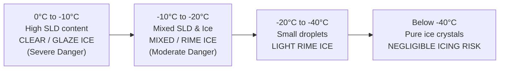
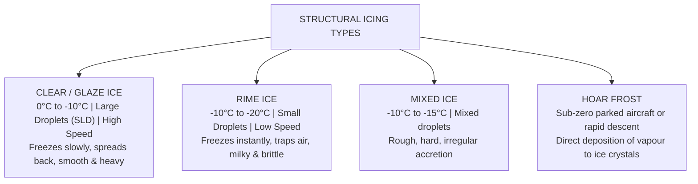
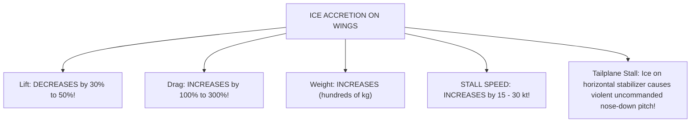

# Chapter 12: Aircraft Icing & Accretion Hazards

> **DGCA Syllabus:** Conditions favorable for structural and induction icing, Supercooled Liquid Water (SLW), Supercooled Large Droplets (SLD), Clear/Glaze ice, Rime ice, Mixed ice, Hoar frost, aerodynamic penalties (lift reduction, drag increase, stall speed increase), Carburettor icing, Anti-icing vs De-icing systems.  
> **Primary References:** IC Joshi Chapter 12; Oxford/Nordian Chapter 14; Volare Question Bank.

---

## 🚀 1. Keyword Core Concepts

- **Structural Icing Conditions:** Requires TWO factors simultaneously:
  1. **Visible Liquid Moisture** in the atmosphere (clouds, freezing rain, drizzle, or fog).
  2. **Airframe Surface Temperature at or below $0^\circ\text{C}$** ($0^\circ\text{C}\text{ to }-40^\circ\text{C}$).
- **The Temperature Danger Zones:**
  - **$0^\circ\text{C}\text{ to }-10^\circ\text{C}$:** **MOST DANGEROUS!** High concentration of Supercooled Large Droplets (SLD) $\implies$ Forms severe **Clear / Glaze Ice**!
  - **$-10^\circ\text{C}\text{ to }-20^\circ\text{C}$:** Mixture of supercooled droplets and ice crystals $\implies$ Forms **Mixed Ice** and **Rime Ice**.
  - **$-20^\circ\text{C}\text{ to }-40^\circ\text{C}$:** Mostly small droplets $\implies$ Light **Rime Ice**.
  - **Below $-40^\circ\text{C}$:** Spontaneous freezing (homogenous nucleation) occurs $\implies$ Clouds consist almost entirely of dry ice crystals $\implies$ Ice crystals do not adhere to cold airframes; structural icing risk is negligible!

---

## 🧊 2. Structural Icing Types: The Master Comparison

### Complete Structural Ice Matrix:
| Ice Type | Temperature Range | Droplet Size & Cloud Type | Freezing Mechanism | Physical Appearance & Hazard Level |
| :--- | :--- | :--- | :--- | :--- |
| **Clear Ice (Glaze)** | **$0^\circ\text{C}\text{ to }-10^\circ\text{C}$** | **Large droplets (SLD)** in **`Cb`, `Cu`, `Ns`**, or Freezing Rain | **Freezes SLOWLY**. Droplet impacts leading edge, only a fraction freezes instantly; the remainder flows rearward over aerofoil before freezing. | Smooth, glassy, transparent, heavy, highly adhesive. **Most dangerous!** Distorts wing camber, destroys laminar airflow, difficult to dislodge with boots. |
| **Rime Ice** | **$-10^\circ\text{C}\text{ to }-20^\circ\text{C}$** | **Small droplets** in **`St`, `Sc`, `As`** (stratiform clouds) | **Freezes INSTANTANEOUSLY**. Droplet freezes on initial contact without spreading; traps tiny air bubbles inside. | Milky white, opaque, rough granular surface, brittle. Confined to leading edges; easily shed by de-icing boots. |
| **Mixed Ice** | **$-10^\circ\text{C}\text{ to }-15^\circ\text{C}$** | Mixture of small and large droplets in convective or deep stratiform | Simultaneous rapid and slow freezing. | Rough, grey, irregular mushroom-like horns on leading edges. High drag penalty. |
| **Hoar Frost** | Surface $<0^\circ\text{C}$ | Water vapour (Clear air) | **Direct Deposition (Sublimation)**: Vapour turns directly into ice crystals on cold metal skin. | White crystalline feathery coating. Disables laminar flow; increases stall speed by $10-15\%$! **Must be removed before takeoff!** |

---

## ✈️ 3. Aerodynamic Penalties of Airframe Icing

> **Crucial Rule:** Even a thin layer of frost or ice equivalent to coarse sandpaper on the wing leading edge can reduce wing maximum lift by **$30\%$** and increase drag by **$40\%$**, causing aerodynamic stall at normal takeoff rotation speeds!

---

## ⛽ 4. Carburettor & Induction Icing

Carburettor icing can occur **IN CLEAR AIR (No Clouds!)** with outside air temperatures as high as **$+25^\circ\text{C}\text{ to }+30^\circ\text{C}$** and high relative humidity ($>50\%$)!

### The Two Cooling Mechanisms:
1. **Fuel Vaporization Cooling:** Liquid avgas sprayed from the jet absorbs latent heat of vaporization, cooling the intake air by **$\approx 15^\circ\text{C}$**.
2. **Venturi / Throttle Butterfly Expansion:** Pressure drop in the carburettor venturi and across the partially closed throttle valve causes adiabatic cooling of **$\approx 5^\circ\text{C}$**.
3. **Total Temperature Drop:** Up to **$20^\circ\text{C}$** across the carburettor!
   - If ambient OAT is $+15^\circ\text{C}$, the carburettor throat temperature drops to **$-5^\circ\text{C}$**.
   - Any moisture in the air condenses and freezes solid on the throttle butterfly, choking fuel/air flow to the engine!

### Carburettor Heat Operation:
- **Indication of Carb Icing:** In fixed-pitch propeller aircraft $\to$ **Drop in Engine RPM**; in constant-speed propeller aircraft $\to$ **Drop in Manifold Pressure**.
- **Action:** Apply full Carburettor Heat. Initial drop in RPM will occur (hot air is less dense), followed by rough running as ice melts through the engine, then RPM recovers!

---

## 🛡️ 5. De-Icing vs Anti-Icing Systems

| System Type | Operating Philosophy | Timing of Activation | Common Mechanisms |
| :--- | :--- | :--- | :--- |
| **Anti-Icing** | **Prevention**: Prevents ice from adhering to surfaces | Activated **BEFORE** entering icing conditions (based on OAT $\le +10^\circ\text{C}$ and visible moisture) | Hot bleed air (engine cowl & wing leading edges), electrical heating (pitot tubes, static ports, windshields), TKS fluid. |
| **De-Icing** | **Removal**: Removes ice after a thin layer has accreted | Activated **AFTER** a measurable accumulation of ice (e.g., $1/4\text{ to }1/2\text{ inch}$) | Pneumatic rubber boots (inflatable rubber bladders that crack and shed brittle ice). |

---

## 📝 6. Practice Exam Questions (From Question Bank)

#### Q1 (Ref #277): During the formation of rime ice in flight, water droplets freeze:
- **A:** Slowly and do not spread out.
- **B:** Slowly and spread out.
- **C:** Rapidly and spread out.
- **D:** Rapidly and do not spread out.

<b>View Answer</b>

<b>Correct Answer: Option D (Rapidly and do not spread out)</b>  
<i>Explanation:</i> Rime ice forms at cold temperatures ($-10^\circ\text{C}$ to $-20^\circ\text{C}$) with small droplets. The latent heat is dissipated instantly, freezing the droplet immediately upon impact without allowing it to flow or spread out, trapping air within the structure.

#### Q2 (Ref #384): Under which conditions is carburettor icing most likely to occur?
- **A:** High humidity (RH > 50%) and ambient air temperatures between -5°C and +25°C.
- **B:** Zero humidity at temperatures below -40°C.
- **C:** Clear skies at FL 350 with OAT of -56°C.
- **D:** Full throttle takeoff roll on a cold dry winter runway.

<b>View Answer</b>

<b>Correct Answer: Option A</b>.

