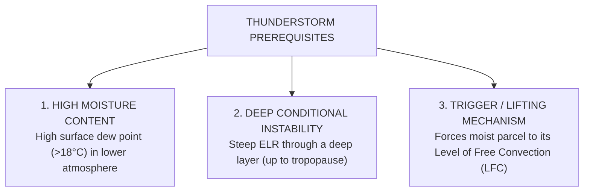
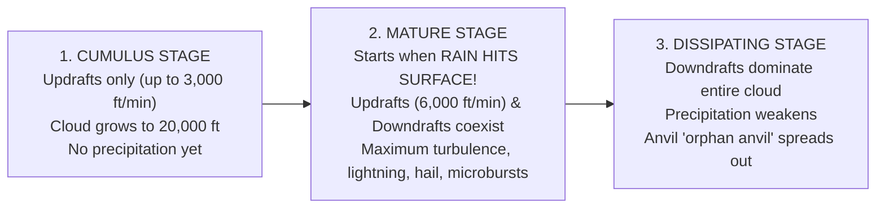
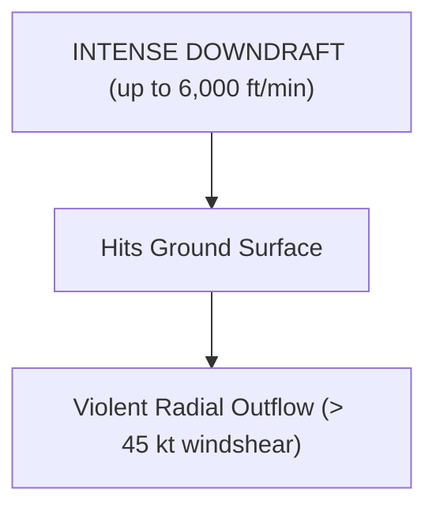
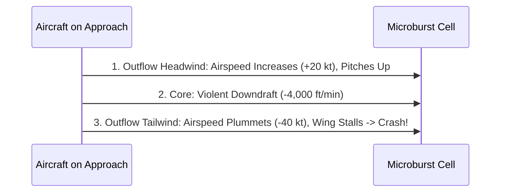

# Chapter 13: Thunderstorms, Microbursts & Severe Weather

> **DGCA Syllabus:** Prerequisites for thunderstorm formation, the 3 life-cycle stages (Cumulus, Mature, Dissipating), Supercells, Multicell clusters, Squall lines, Microbursts and Low-Level Wind Shear (LLWS), Gust fronts and Roll clouds, Hail hazards, Lightning, Airborne weather radar detection, and in-flight avoidance techniques.  
> **Primary References:** IC Joshi Chapter 13; Oxford/Nordian Chapter 16; Volare Question Bank.

---

## 🚀 1. The 3 Essential Ingredients for a Thunderstorm

A thunderstorm (**`Cb`**) cannot develop unless **ALL THREE** of the following conditions exist simultaneously:

### Triggering Mechanisms:
- **Thermal Convection:** Solar heating of dry land in summer (Air Mass / Heat Thunderstorms).
- **Orographic Lift:** Moist wind forced up mountain barriers (e.g., Western Ghats, Himalayas).
- **Frontal Lifting:** Cold dense air wedging beneath warm moist air (Cold Front Thunderstorms).
- **Convergence:** Intertropical Convergence Zone (ITCZ) or monsoon trough convergence.

---

## ⚡ 2. The 3 Stages of a Thunderstorm Cell

A single-cell thunderstorm lasts roughly **$45\text{ to }60\text{ minutes}$** and progresses through three distinct stages:

### Comparative Breakdown of Stages:
| Stage | Typical Duration | Dominant Vertical Motion | Precipitation | Defining Diagnostic Features |
| :--- | :--- | :--- | :--- | :--- |
| **1. Cumulus (Building)** | $15\text{ to }20\text{ minutes}$ | **Updrafts ONLY** (speeds $1,000-3,000\text{ ft/min}$) | None hitting ground | Rapid vertical growth of towering cumulus (`TCU`); droplets suspended by strong updrafts. |
| **2. Mature** | **$20\text{ to }30\text{ minutes}$** | **Updrafts AND Downdrafts coexist** side by side! | **Heavy rain, hail, or snow** | **Starts the precise moment rain reaches the ground!** Anvil top (`incus`) develops. Maximum severe turbulence, lightning, and microbursts. |
| **3. Dissipating** | $20\text{ to }30\text{ minutes}$ | **Downdrafts ONLY** throughout cell | Rain gradually stops | Downdrafts starve the cell of warm moist inflow. Cloud top frays into fuzzy stratiform anvil. |

---

## 🌪️ 3. Microbursts & Low-Level Wind Shear (LLWS)

A **Microburst** is an extremely intense, localized column of sinking air (downdraft) that hits the ground and fans out violently in all directions.

### Microburst Critical Parameters:
- **Spatial Dimension:** Core diameter **$< 4\text{ km}$** ($2.2\text{ NM}$); outflow extends to $\approx 5\text{ km}$.
- **Temporal Duration:** Peak intensity lasts **$2\text{ to }5\text{ minutes}$**; total lifespan $< 15\text{ minutes}$.
- **Wind Shear Velocity Difference:** Across the core can exceed **$45\text{ to }90\text{ knots}$**!
- **Vertical Downdraft Speed:** Up to **$6,000\text{ ft/min}$** ($30\text{ m/s}$).

### Aircraft Encounter Profile on Final Approach:
1. **Entry (Increasing Headwind):** Aircraft encounters strong outflow headwind $\implies$ Airspeed jumps $\implies$ Aircraft balloons above glide slope. *Pilot reaction: reduces engine power and pushes nose down.*
2. **Core (Violent Downdraft):** Aircraft enters central downdraft $\implies$ Severe sink rate.
3. **Exit (Abrupt Severe Tailwind):** Aircraft encounters tailwind outflow $\implies$ Indicated airspeed drops catastrophically by $30-50\text{ kt} \implies$ Loss of lift, aerodynamic stall, and ground impact before engines can spool up!

---

## 🛡️ 4. In-Flight Thunderstorm Avoidance Rules

1. **Distance Clearances (ICAO / FAA / DGCA Standards):**
   - Below FL 200: Clear any severe storm echo by at least **$10\text{ to }15\text{ NM}$**.
   - Above FL 200: Clear by at least **$20\text{ NM}$**!
   - Clear the **downwind side (under the anvil)** by at least **$20\text{ NM}$** because violent updrafts inside the Cb shoot large hail stones miles out through the anvil into apparently clear air!
2. **Overflying a Cb:**
   - If overflying is unavoidable, clear the cloud top by at least **$1,000\text{ ft}$ for every $10\text{ knots}$ of wind speed** at that level (minimum clearance $5,000\text{ ft}$ above the top).
3. **Penetration Rules (If Trapped inside Cb):**
   - **Do NOT turn back** (structural stress is doubled in a turn, and you may fly into the core).
   - Set **Turbulence Penetration Speed ($V_B$ / $V_{RA}$)**.
   - Maintain a **constant pitch attitude**; do NOT fight altitude variations (let the altimeter drift, fighting altitude stresses the wings!).
   - Turn cockpit lights to **FULL BRIGHT** to prevent temporary blindness from lightning flash.

---

## 📝 5. Practice Exam Questions (From Question Bank)

#### Q1 (Ref #278): The mature stage of a thunderstorm cell is defined as beginning when:
- **A:** The cloud first reaches the freezing level.
- **B:** Rain or precipitation first reaches the ground surface.
- **C:** Downdrafts completely replace updrafts.
- **D:** Lightning is first recorded on ADF.

<b>View Answer</b>

<b>Correct Answer: Option B (Precipitation reaches the surface)</b>  
<i>Explanation:</i> The onset of precipitation at the surface marks the development of the precipitation-induced downdraft alongside the existing updraft, which defines the Mature stage.

#### Q2: What is the primary hazard to an aircraft encountering a microburst on landing approach?
- **A:** Severe carburettor icing.
- **B:** A sudden loss of airspeed and lift caused by transitioning rapidly from a strong headwind into a severe tailwind.
- **C:** Compass deviation caused by static discharge.
- **D:** High barometric pressure causing altimeter under-reading.

<b>View Answer</b>

<b>Correct Answer: Option B</b>.

