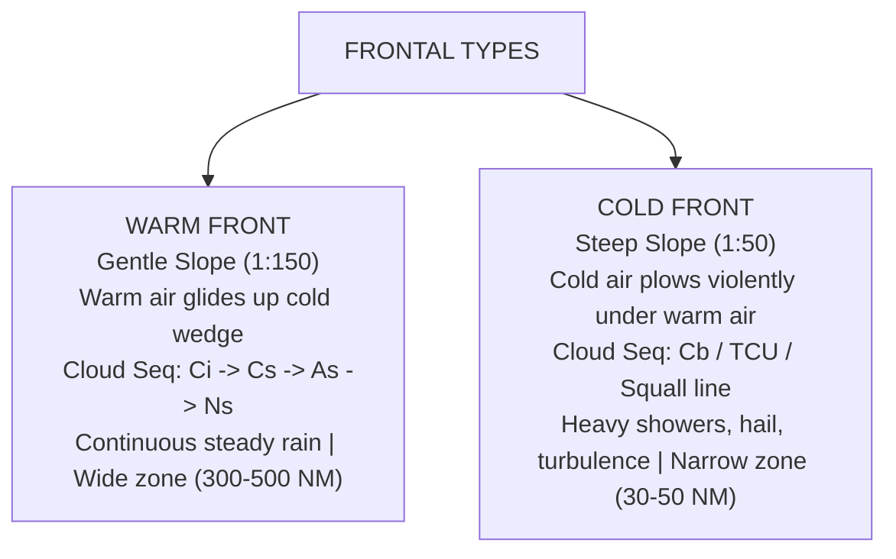
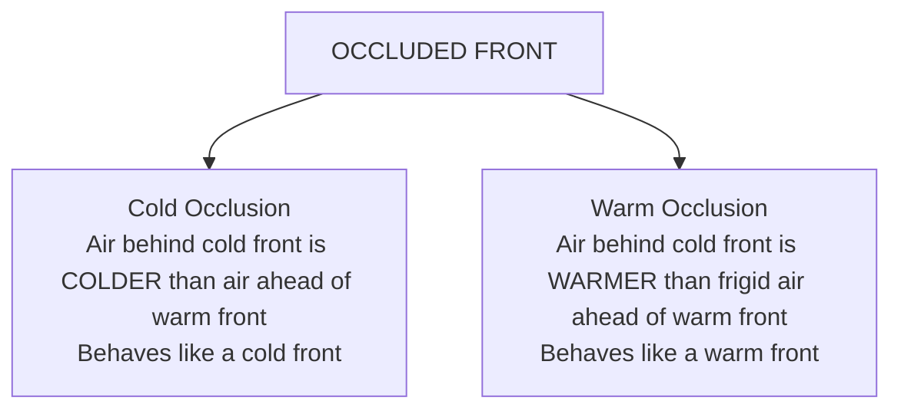
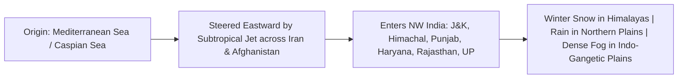

# Chapter 14: Air Masses, Fronts & Frontal Depressions

> **DGCA Syllabus:** Air mass classification (cT, cP, cA, mT, mP), Fronts (Warm front, Cold front, Stationary front, Occlusions), cloud sequences, weather changes across frontal boundaries, Polar front depression life-cycle, Western Disturbances (origin, track, and weather over India).  
> **Primary References:** IC Joshi Chapter 14; Oxford/Nordian Chapters 10 & 11; Volare Question Bank.

---

## 🚀 1. Keyword Core Concepts

- **Air Mass:** An immense body of air, horizontally uniform in temperature and moisture characteristics over thousands of kilometers.
- **Source Region:** Large, flat, uniform surface of the Earth (ocean, ice sheet, desert) with light winds where air remains stagnant for days acquiring surface properties.
- **Classification Code:**
  - Moisture: **`c`** (Continental = Dry) vs **`m`** (Maritime = Moist).
  - Temperature: **`P`** (Polar = Cold), **`T`** (Tropical = Warm), **`A`** (Arctic = Frigid), **`E`** (Equatorial = Very Warm & Humid).

---

## ⚔️ 2. Warm Front vs Cold Front: The Master Comparison

### Complete Weather Comparison Across Fronts (Northern Hemisphere):
| Element | Warm Front Passage | Cold Front Passage |
| :--- | :--- | :--- |
| **Slope** | **Gentle: $1:150$** (Warm air slides up smoothly) | **Steep: $1:50\text{ to }1:80$** (Cold air acts like a bulldozer) |
| **Speed** | Slower ($10-20\text{ kt}$) | Faster ($20-35\text{ kt}$) |
| **Cloud Sequence Ahead** | **$\text{Ci} \to \text{Cs} \to \text{As} \to \text{Ns}$** (Precursor 600 NM ahead!) | Cumulus, Towering Cumulus, **Cumulonimbus (`Cb`)** |
| **Precipitation** | **Continuous steady rain or drizzle** over wide band ($200-400\text{ NM}$) | **Intense showers, hail, lightning**, narrow squall band ($20-50\text{ NM}$) |
| **Pressure Trend** | Falls steadily ahead $\to$ Levels off in warm sector | Falls ahead $\to$ **Rises abruptly (sharp pressure kick!)** behind |
| **Wind Shift (NH)** | **Veers** (e.g., $180^\circ \to 240^\circ$) | **Veers sharply** (e.g., $240^\circ \to 320^\circ$) with violent gusts |
| **Temperature** | Rises after passage | **Drops sharply** ($5-15^\circ\text{C}$ drop) |
| **Dew Point** | Rises | Drops sharply |
| **Visibility** | Poor (mist, fog, steady rain) | Very poor during front $\to$ **Exceptional / crystal clear** behind! |

---

## 🔄 3. Occluded Fronts (Occlusions)

Because cold fronts move significantly faster than warm fronts ($2\times$ speed), the cold front eventually catches up with the warm front, lifting the entire warm sector off the ground!

---

## 🇮🇳 4. Western Disturbances (India's Winter Weather System)

> **Western Disturbances (WD):** Shallow extra-tropical cyclonic depressions that originate over the **Mediterranean Sea, Black Sea, or Caspian Sea**, embedded in the **Subtropical Westerly Jet Stream**.

### Key Aviation & Climatological Impacts of WD:
1. **Winter Precipitation (December to March):**
   - Brings moderate to heavy **snowfall** over Jammu & Kashmir, Ladakh, Himachal Pradesh, and Uttarakhand.
   - Brings vital winter rains (**Mawat**) to Punjab, Haryana, Rajasthan, and Western UP, essential for the *Rabi* (wheat) crop.
2. **Dense Radiation Fog Hazard:**
   - Rain from a passing WD moistens the soil.
   - Clear skies and light winds immediately behind the WD trigger **widespread, severe radiation fog** across Delhi, Punjab, and Uttar Pradesh, causing catastrophic flight disruptions at Delhi (VIDP).
3. **Cold Wave:** Behind the WD, frigid northerly winds from the snow-covered Himalayas cause severe **Cold Wave conditions** across Northern and Central India.

---

## 📝 5. Practice Exam Questions (From Question Bank)

#### Q1 (Ref #264): What is the typical cloud sequence observed ahead of an approaching warm front?
- **A:** Cb followed by St and then Ci.
- **B:** Cirrus, Cirrostratus, Altostratus, and Nimbostratus.
- **C:** Stratocumulus, Cumulus, and Altocumulus.
- **D:** Stratus, Fog, and Clear skies.

<b>View Answer</b>

<b>Correct Answer: Option B (Ci -> Cs -> As -> Ns)</b>.

#### Q2: What causes the intense winter fog in the Indo-Gangetic Plains following a Western Disturbance?
- **A:** Warm sea breezes from the Bay of Bengal.
- **B:** Soil moistening by WD rainfall followed by clear skies and radiative nighttime cooling in the high-pressure ridge behind the system.
- **C:** Katabatic winds blowing directly from the Indian Ocean.
- **D:** Industrial smoke trapping without moisture.

<b>View Answer</b>

<b>Correct Answer: Option B</b>.

