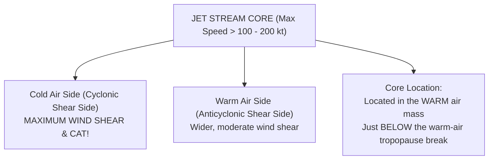

# Chapter 15: Jet Streams & Clear Air Turbulence (CAT)

> **DGCA Syllabus:** Definition and dimensions of Jet Streams, Polar Front Jet (PFJ), Subtropical Westerly Jet (STJ), Tropical Easterly Jet (TEJ), Somali Low-Level Jet, core location relative to tropopause, Clear Air Turbulence (CAT) causes, location of maximum windshear, and pilot avoidance/escape procedures.  
> **Primary References:** IC Joshi Chapter 15; Oxford/Nordian Chapter 12; Volare Question Bank.

---

## 🚀 1. WMO Definition & Jet Stream Dimensions

- **WMO Definition:** A strong, narrow, quasi-horizontal current of wind, concentrated along a quasi-horizontal axis in the upper troposphere or stratosphere, characterized by strong vertical and lateral wind shears and featuring one or more velocity maxima.
- **Minimum Speed Threshold:** The wind speed along the jet axis must be **at least $60\text{ knots}$** ($110\text{ km/h} \approx 30\text{ m/s}$).
- **Standard Dimensions:**
  - **Length:** Thousands of kilometers ($1,500\text{ to }5,000\text{ km}$).
  - **Width:** Hundreds of kilometers ($100\text{ to }500\text{ km}$).
  - **Depth (Thickness):** Several kilometers ($1\text{ to }5\text{ km}$).

---

## 🌐 2. The 4 Major Jet Streams in Aviation

| Jet Stream | Direction | Typical Flight Level | Seasonal Behavior | Key Aviation & Indian Climatology Significance |
| :--- | :--- | :--- | :--- | :--- |
| **Polar Front Jet (PFJ)** | **Westerly** ($270^\circ$) | **FL 300 to FL 350** ($9-10\text{ km} \approx 300\text{ hPa}$) | Strongest in winter ($150-250\text{ kt}$); shifts equatorward | Associated with polar front; severe CAT. |
| **Subtropical Jet (STJ)** | **Westerly** ($270^\circ$) | **FL 400** ($12\text{ km} \approx 200\text{ hPa}$) | Highly persistent in winter over North India ($25^\circ-30^\circ\text{N}$) | Steers Western Disturbances into India. Disappears/shifts north of Himalayas in summer. |
| **Tropical Easterly Jet (TEJ)**| **EASTERLY** ($090^\circ$) | **FL 450 to FL 500** ($14-16\text{ km} \approx 100-150\text{ hPa}$) | **Summer ONLY** (June to September) | Runs from South China Sea across Peninsular India ($12^\circ-15^\circ\text{N}$) to Africa. **Essential driver of Indian Southwest Monsoon!** |
| **Somali Jet (LLJ)** | **South-Westerly** | **$850\text{ hPa}$** ($1.5\text{ km} \approx 5,000\text{ ft}$) | **Summer ONLY** (SW Monsoon) | Low-level jet blowing from Somali coast across Arabian Sea; feeds intense moisture into Western Ghats. |

---

## 🌪️ 3. Clear Air Turbulence (CAT): High-Yield Facts

Clear Air Turbulence (CAT) is high-altitude turbulence occurring in cloud-free air, without visual meteorological cues.

### 1. Primary Locations of Severe CAT:
- **Cold Air / Cyclonic Side of Jet Core:** Horizontal wind shear is much stronger on the polar/cold side of the jet stream core than on the equatorial/warm side.
- **Directly above and below the Jet Core:** Where vertical wind shear is maximum ($>6\text{ kt}$ per $1,000\text{ ft}$).
- **Tropopause Breaks:** Around sharp folds where polar and subtropical air masses meet.
- **Mountain Wave Interaction:** Where jet streams cross mountain ranges perpendicular to the ridge.

### 2. Pilot Action & Escape Techniques for CAT:
1. **Vertical Escape is Fastest:**  
   Because vertical wind shear ($>6-10\text{ kt}/1,000\text{ ft}$) is thousands of times sharper than horizontal shear, a climb or descent of **$2,000\text{ to }4,000\text{ ft}$** exits the turbulent shear layer faster than flying horizontally!
2. **Speed Management:**  
   Immediately reduce airspeed to recommended **Turbulence Penetration Speed ($V_B$ / $V_{RA}$)**.
3. **Temperature Trend Rule:**
   - Flying across a jet stream, watch the outside air temperature (OAT) gauge:
     - If temperature is **falling rapidly** $\implies$ You are penetrating into the cold (cyclonic) side $\implies$ **Expect severe CAT!**
     - If temperature stops falling and levels off $\implies$ You have crossed the tropopause boundary.

---

## 📝 4. Practice Exam Questions (From Question Bank)

#### Q1 (Ref #268): Where, as a general rule, is the core of the polar front jet stream to be found?
- **A:** In the warm air mass.
- **B:** In the cold air mass.
- **C:** Just above the warm-air tropopause.
- **D:** Just below the cold-air tropopause.

<b>View Answer</b>

<b>Correct Answer: Option A (In the warm air mass)</b>  
<i>Explanation:</i> The jet stream core lies in the warm air mass, in the upper troposphere, just below the tropopause break on the warm side of the polar front.

#### Q2: The Tropical Easterly Jet (TEJ) is an upper-level wind system that:
- **A:** Blows westerly across Central Europe in winter.
- **B:** Blows easterly across Peninsular India at FL 450-500 during the Southwest Monsoon summer months.
- **C:** Operates exclusively at sea level over Antarctica.
- **D:** Dissipates the Indian monsoon rains.

<b>View Answer</b>

<b>Correct Answer: Option B</b>.

