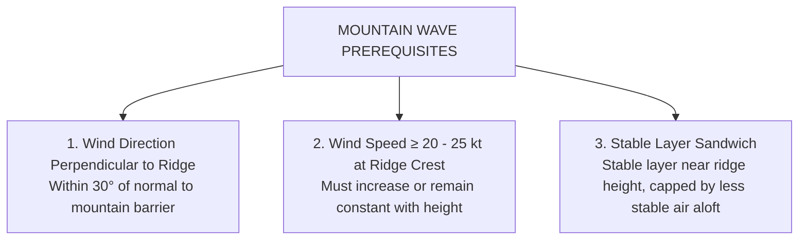
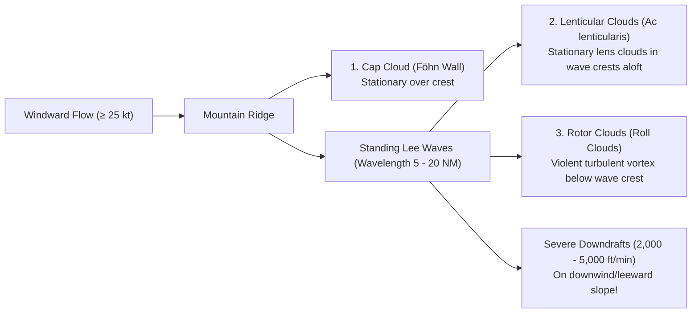

# Chapter 16: Mountain Waves & Orographic Hazards

> **DGCA Syllabus:** Conditions required for Mountain Wave (Standing Lee Wave) formation, wave anatomy (Cap cloud, Lenticular clouds, Rotor clouds), hazards (severe downdrafts, altimeter errors, turbulence), and mountain flying rules of thumb.  
> **Primary References:** IC Joshi Chapter 17; Oxford/Nordian Chapter 18; Volare Question Bank.

---

## 🚀 1. The 3 Prerequisites for Mountain Waves

---

## 🏔️ 2. Anatomy of a Mountain Wave System

### Key Cloud Markers:
1. **Cap Cloud (Föhn Wall):** Sits directly over the mountain ridge. Air rises up the windward slope, condenses at the crest, then plunges down the leeward slope, dissipating by adiabatic warming.
2. **Lenticular Clouds (`Ac lenticularis`):** Smooth, lens-shaped clouds formed at the crest of each standing wave downwind. **They appear stationary even in winds $>60\text{ kt}$** because water continuously condenses at the upwind edge and evaporates at the downwind edge!
3. **Rotor Clouds:** Violent cylindrical tumbling roll clouds formed beneath the wave crests near ridge level. The most dangerous turbulence zone in the atmosphere!

---

## ⚠️ 3. Flight Hazards in Mountainous Terrain

1. **Catastrophic Downdrafts:**  
   - Sinking air on the leeward slope can exceed **$3,000\text{ to }5,000\text{ ft/min}$**, far exceeding the maximum climb capability of most transport aircraft!
2. **Severe Altimeter Over-Reading (Venturi Effect):**  
   - High-speed airflow squeezing over the mountain crest accelerates (Bernoulli's principle), creating a localized **pressure drop**.
   - An altimeter senses this low pressure and assumes the aircraft is higher than it really is.
   - Combined with cold air column error, the altimeter can **over-read by $1,000\text{ to }2,000\text{ ft}$** $\implies$ The pilot flies into the mountain in IMC!
3. **Severe Structural Turbulence in Rotors:**  
   - Extreme vertical gust loads can cause structural airframe failure.

---

## 🛫 4. Mountain Flying Pilot Techniques

- **Crossing Angle:** Cross ridges at a **$45^\circ\text{ angle}$**, never at $90^\circ$ (perpendicular). A $45^\circ$ approach allows a quick $90^\circ$ turn away from the mountain if unmanageable downdrafts are encountered!
- **Terrain Clearance:** Maintain a minimum terrain clearance of at least **$3,000\text{ to }5,000\text{ ft}$** above the highest ridge in mountain wave conditions.
- **Flight Path:** Never fly up the center of a narrow mountain valley; hug the upwind (lift) side of the valley to preserve turnaround room.

---

## 📝 5. Practice Exam Questions

#### Q1: Which combination of atmospheric factors is necessary for the development of standing mountain waves?
- **A:** Calm surface winds, unstable air mass, and dense cumulonimbus clouds.
- **B:** Strong wind (≥ 20 kt) blowing roughly perpendicular to a ridge, wind increasing with height, and a marked stable layer near crest level.
- **C:** Gale force winds blowing parallel to the mountain valley in summer.
- **D:** Strong frontal inversion in flat terrain.

<b>View Answer</b>

<b>Correct Answer: Option B</b>.

#### Q2: What altimeter error occurs when flying over high mountain ridges in strong winds?
- **A:** The altimeter under-reads, indicating lower than true altitude.
- **B:** The altimeter over-reads due to dynamic pressure drop (Bernoulli effect), causing the aircraft to fly dangerously closer to terrain than indicated.
- **C:** The altimeter indicates zero.
- **D:** The error depends solely on humidity.

<b>View Answer</b>

<b>Correct Answer: Option B</b>.

