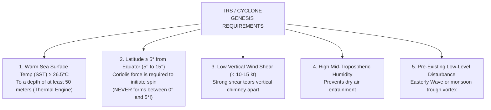
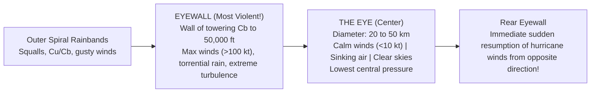
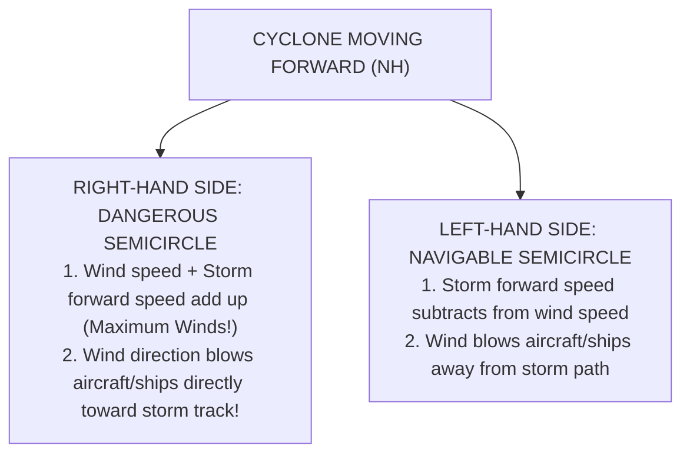

# Chapter 17: Tropical Meteorology & Cyclones

> **DGCA Syllabus:** Tropical weather characteristics, Intertropical Convergence Zone (ITCZ), Easterly Waves, Tropical Revolving Storms (TRS / Cyclones), genesis requirements, structural anatomy (Eye, Eyewall, Spiral bands), IMD storm classification in North Indian Ocean, Dangerous vs Navigable semicircle.  
> **Primary References:** IC Joshi Chapter 18; Oxford/Nordian Chapter 17; Volare Question Bank.

---

## 🚀 1. Characteristics of Tropical Weather

- **Latitude Band:** Between $30^\circ\text{N}$ and $30^\circ\text{S}$.
- **Weak Pressure Gradients:** Horizontal pressure differences are very small; isobaric analysis is generally replaced by **Streamline and Isotach analysis**.
- **Negligible Coriolis Force near the Equator:** Geostrophic balance breaks down within $5^\circ$ to $10^\circ$ of the Equator. Wind blows almost directly down the pressure gradient.
- **Diurnal Variation Dominates:** Daily cycle of solar heating and nocturnal cooling drives almost all local weather (land/sea breezes, afternoon thunderstorms).
- **Intertropical Convergence Zone (ITCZ):**
  - The equatorial trough where the Trade Winds of both hemispheres converge (NE Trades meeting SE Trades).
  - Characterized by sluggish, calm winds (**The Doldrums**), towering cumulonimbus lines, heavy convective rain, and severe turbulence.
  - Migrates north during the Northern Hemisphere summer (reaching $20^\circ-25^\circ\text{N}$ over India as the Monsoon Trough) and south during winter.

---

## 🌀 2. Tropical Revolving Storms (TRS): Genesis Requirements

A Tropical Revolving Storm is an intense cyclonic vortex originating over warm tropical oceans.

### Global Nomenclature:
| Ocean Basin | Local Name |
| :--- | :--- |
| **Bay of Bengal & Arabian Sea (North Indian Ocean)** | **Cyclonic Storm (Cyclone)** |
| **North Atlantic Ocean & Northeast Pacific** | **Hurricane** |
| **Northwest Pacific Ocean (China, Japan, Philippines)**| **Typhoon** |
| **South Indian Ocean & Southwest Pacific (Australia)** | **Tropical Cyclone (formerly Willy-Willy)** |

---

## 👁️ 3. Anatomy of a Mature Cyclone

### Structural Features:
1. **The Eye:**
   - Central core, diameter typically $20\text{ to }50\text{ km}$ ($10-30\text{ NM}$).
   - **Calm or light winds ($<10\text{ kt}$)**, descending/subsiding warm air, clear skies or scattered low stratus, zero precipitation.
   - Lowest barometric pressure (frequently drops below $950\text{ hPa}$, record lows $<880\text{ hPa}$).
2. **The Eyewall:**
   - Dense circular ring of towering cumulonimbus clouds surrounding the eye, extending up to $50,000-60,000\text{ ft}$.
   - **Location of maximum sustained wind speeds**, highest storm surge, torrential rain, and extreme turbulence.
3. **Spiral Feeder Rainbands:**
   - Long curved bands of convective showers spiraling inward toward the center across hundreds of kilometers.

---

## 🧭 4. Dangerous vs Navigable Semicircle (Northern Hemisphere)

When facing in the direction of the cyclone's movement (track):

---

## 🇮🇳 5. IMD Cyclone Classification (North Indian Ocean)

The India Meteorological Department (IMD) classifies cyclonic disturbances by maximum sustained $3$-minute surface wind speed:

| Category | Sustained Wind Speed (Knots) | Wind Speed (km/h) | Pressure Deficit |
| :--- | :--- | :--- | :--- |
| **Low Pressure Area** | $< 17\text{ kt}$ | $< 31\text{ km/h}$ | $< 1\text{ hPa}$ |
| **Depression (`D`)** | **$17\text{ to }27\text{ kt}$** | $31\text{ to }49\text{ km/h}$ | $1-3\text{ hPa}$ |
| **Deep Depression (`DD`)** | **$28\text{ to }33\text{ kt}$** | $50\text{ to }61\text{ km/h}$ | $3-4.5\text{ hPa}$ |
| **Cyclonic Storm (`CS`)** | **$34\text{ to }47\text{ kt}$** | $62\text{ to }88\text{ km/h}$ | $4.5-8.5\text{ hPa}$ |
| **Severe Cyclonic Storm (`SCS`)** | **$48\text{ to }63\text{ kt}$** | $89\text{ to }117\text{ km/h}$ | $8.5-15.5\text{ hPa}$ |
| **Very Severe Cyclonic Storm (`VSCS`)** | **$64\text{ to }89\text{ kt}$** | $118\text{ to }166\text{ km/h}$ | $15.5-31.5\text{ hPa}$ |
| **Extremely Severe Cyclonic Storm (`ESCS`)**| **$90\text{ to }119\text{ kt}$** | $167\text{ to }221\text{ km/h}$ | $31.5-65.5\text{ hPa}$ |
| **Super Cyclonic Storm (`SuCS`)** | **$\ge 120\text{ kt}$** | **$\ge 222\text{ km/h}$** | $> 65.5\text{ hPa}$ |

---

## 📝 6. Practice Exam Questions

#### Q1: Why do Tropical Revolving Storms never form between 0° and 5° latitude?
- **A:** The sea surface temperature is too cold.
- **B:** The Coriolis force is zero or negligible near the equator, which prevents cyclonic rotation from initiating.
- **C:** The trade winds blow too fiercely.
- **D:** High vertical wind shear always exists at the equator.

<b>View Answer</b>

<b>Correct Answer: Option B (Coriolis force is negligible)</b>.

#### Q2: What weather is encountered inside the Eye of a mature Tropical Cyclone?
- **A:** Maximum winds and extreme hail.
- **B:** Light winds, subsiding air, little or no cloud, and absence of precipitation.
- **C:** Violent low-level squalls and dense fog.
- **D:** Continuous towering cumulonimbus with severe icing.

<b>View Answer</b>

<b>Correct Answer: Option B</b>.

