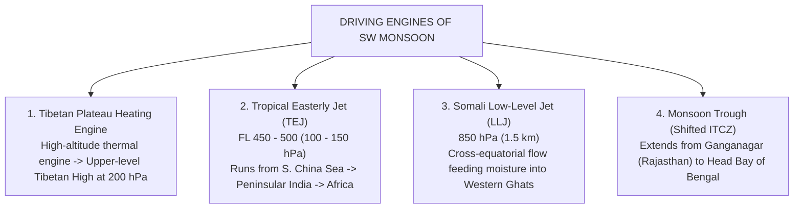
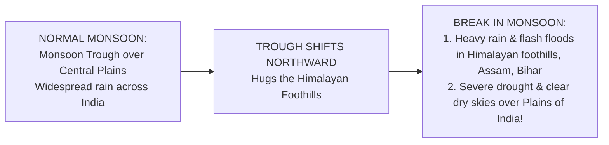

# Chapter 18: Climatology of India & Monsoons

> **DGCA Syllabus:** Climatological seasons of India (Winter, Pre-Monsoon, SW Monsoon, Post-Monsoon), Southwest Monsoon mechanism, Somali Jet, Tropical Easterly Jet, Tibetan High, Monsoon Trough, Breaks in Monsoon, Northeast Monsoon, Pre-monsoon severe storms (Nor'westers/Kalbaishakhi, Andhi, Loo), Western Disturbances, and Indo-Gangetic winter fog.  
> **Primary References:** IC Joshi Chapter 19; Volare Question Bank.

---

## 🚀 1. The 4 Climatological Seasons of India (IMD Definition)

1. **Winter (Cold Weather Season):** January to February.
2. **Pre-Monsoon (Hot Weather / Summer Season):** March to May.
3. **Southwest Monsoon (Rainy Season):** June to September.
4. **Post-Monsoon (Retreating Monsoon Season):** October to December.

---

## 🌧️ 2. The Southwest Monsoon (June to September)

The Southwest Monsoon accounts for **over $75\%$** of India's total annual rainfall.

### Onset & Advance:
- **Onset Date:** Standard normal onset date over **Kerala is 1st June** (Car Nicobar $\approx$ 15th-20th May).
- Advances northward in two major branches:
  1. **Arabian Sea Branch:** Hits the steep barrier of the **Western Ghats**, producing torrential orographic rain on the windward coastal belt (Kerala, Karnataka, Goa, Konkan/Mumbai).
  2. **Bay of Bengal Branch:** Moves into Bangladesh and Myanmar, gets deflected by the Arakan mountains and Himalayas, and travels westward along the Gangetic plains.
- Covers the entire Indian subcontinent by **$\approx$ 8th July**.

---

## ⚡ 3. Monsoon Depressions & "Breaks" in Monsoon

### Monsoon Depressions:
- Form at the head of the **Bay of Bengal** (near $20^\circ\text{N}$).
- Move in a **West-Northwesterly (WNW)** direction along the axis of the Monsoon Trough across Central India.
- Cause widespread, heavy, prolonged rainfall in Odisha, West Bengal, MP, Chhattisgarh, and Gujarat.

### "Breaks" in the Monsoon (Crucial Exam Concept!):

- Occurs in **July or August**, typically lasting from a few days to 2 weeks.
- The axis of the monsoon trough shifts from its normal position to the **foothills of the Himalayas**.
- **Rainfall pattern reverses completely:**
  - Plains of India experience **dry, rainless, hot weather**.
  - Himalayan foothills, Assam, and Bihar experience **catastrophic cloudbursts and flooding**.

---

## 🍂 4. The Northeast Monsoon / Post-Monsoon (October to December)

- As the Asian continent cools, high pressure builds over Siberia and North India.
- The ITCZ retreats southward back toward the equator.
- Wind direction reverses: blows from **Northeast to Southwest**.
- Picks up moisture over the warm waters of the **Bay of Bengal**.
- Brings major rainfall ($50-60\%$ of their annual total) to **Tamil Nadu, Coastal Andhra Pradesh, and Rayalaseema**.
- **Peak Season for Destructive Cyclones:** October and November are the most active cyclone months in the Bay of Bengal and Arabian Sea.

---

## 🌪️ 5. Pre-Monsoon Severe Local Storms (March to May)

During the scorching summer months, intense solar insolation interacting with dry continental and moist maritime air triggers violent local convective storms:

| Local Name | Region Affected | Defining Meteorological Characteristics | Aviation Hazard |
| :--- | :--- | :--- | :--- |
| **Nor'westers (Kalbaishakhi)**| **West Bengal, Odisha, Assam, Bihar** | Destructive line of severe Cb thunderstorms moving from the **Northwest**. Accompanied by hurricane-force gusts, torrential rain, and giant hail. | Severe low-level windshear, microbursts, destroyed runways, hail damage. |
| **Andhi (Dust Storm)** | **Rajasthan, Punjab, Haryana, Delhi, Western UP** | Convective downdrafts from dry thunderstorms kicking up choking walls of sand and dust. Often has **no rain reaching ground**! | Visibility drops to **near ZERO** in seconds; engine ingestion of abrasive dust. |
| **Loo** | **Indo-Gangetic Plains (NW & Central India)** | Searing, blisteringly hot and dry westerly wind ($>45^\circ\text{C}$ to $50^\circ\text{C}$), blowing during afternoons of May and June. | Extreme density altitude; drastic reduction in engine thrust and wing lift. |

---

## 📝 6. Practice Exam Questions

#### Q1: What happens during a "Break" in the Southwest Monsoon over India?
- **A:** The monsoon winds reverse to northeasterly throughout the entire troposphere.
- **B:** The monsoon trough moves north to the Himalayan foothills, causing heavy rainfall in the foothills and drought-like dry conditions over the central plains.
- **C:** Rainfall ceases completely over the entire Indian subcontinent and Sri Lanka.
- **D:** Tropical cyclones form simultaneously over Delhi and Nagpur.

<b>View Answer</b>

<b>Correct Answer: Option B</b>.

#### Q2: Kalbaishakhi (Nor'westers) are severe thunderstorms that occur during:
- **A:** Peak winter (January) in Punjab.
- **B:** Pre-monsoon season (March to May) in West Bengal, Odisha, and Assam.
- **C:** Northeast monsoon (November) in Tamil Nadu.
- **D:** Post-monsoon season in Gujarat.

<b>View Answer</b>

<b>Correct Answer: Option B</b>.

