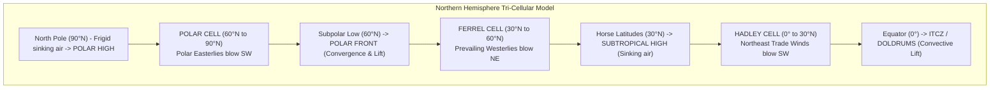

# Chapter 19: General Planetary Circulation

> **DGCA Syllabus:** Tri-cellular planetary circulation model (Hadley, Ferrel, and Polar cells), global pressure belts (Equatorial Low/ITCZ, Subtropical Highs/Horse Latitudes, Subpolar Lows, Polar Highs), global wind systems (Trade Winds, Prevailing Westerlies, Polar Easterlies), seasonal shifts of wind and pressure belts.  
> **Primary References:** IC Joshi Chapter 20; Oxford/Nordian Chapter 13; Volare Question Bank.

---

## 🚀 1. The Tri-Cellular Circulation Model

Because the Earth rotates on its axis and has Coriolis force, the simple single-cell equator-to-pole circulation breaks down into **three distinct cells** in each hemisphere:

### The 3 Atmospheric Cells:
| Cell | Latitude Band | Driving Mechanism | Dominant Surface Winds | Characteristic Weather |
| :--- | :--- | :--- | :--- | :--- |
| **Hadley Cell** | **$0^\circ\text{ to }30^\circ$** | **Thermally Direct** (Warm air rises at Equator, travels poleward aloft, sinks at $30^\circ$) | **Trade Winds** (NE in NH, SE in SH) | Convective squalls and thunderstorms at ITCZ; clear skies and deserts at $30^\circ$. |
| **Ferrel Cell** | **$30^\circ\text{ to }60^\circ$** | **Thermally Indirect** (Forced like a mechanical gear between Hadley and Polar cells) | **Prevailing Westerlies** (SW in NH, NW in SH) | Unsettled, dynamic frontal depressions, mobile lows and highs, variable weather. |
| **Polar Cell** | **$60^\circ\text{ to }90^\circ$** | **Thermally Direct** (Frigid dense air sinks at poles, spreads equatorward, rises at polar front) | **Polar Easterlies** (NE in NH, SE in SH) | Frigid, dry, light precipitation, cold blizzard winds. |

---

## 🌍 2. Global Pressure Belts & Prevailing Winds

### High-Yield Exam Terms:
1. **The Doldrums (Equatorial Trough / ITCZ):**
   - Region between $5^\circ\text{N}$ and $5^\circ\text{S}$ characterized by low pressure, light and baffling calm winds, high humidity, and squally afternoon cumulonimbus storms.
2. **Horse Latitudes (Subtropical Highs):**
   - High pressure belts at $\approx 30^\circ\text{N}$ and $30^\circ\text{S}$.
   - Characterized by calm winds, subsiding dry air, clear skies, and lack of rain. Location of the world's major hot deserts (Sahara, Arabian, Thar, Atacama).
3. **The Trade Winds:**
   - Steady, persistent winds blowing from the Subtropical Highs toward the Equatorial Trough.
   - **Northeast Trades** in the Northern Hemisphere; **Southeast Trades** in the Southern Hemisphere.
   - Most consistent winds on Earth ($15-20\text{ kt}$).
4. **Roaring Forties & Furious Fifties:**
   - In the Southern Hemisphere ($40^\circ\text{S to }60^\circ\text{S}$), there is almost no land barrier.
   - The Westerlies blow uninterrupted across open ocean with gale force and massive swell.

---

## ☀️ 3. Seasonal Migration of Circulation Belts

- As the thermal equator shifts with the Sun's declination:
  - In **July (Northern Summer)**: Entire planetary wind system shifts **North** by $5^\circ\text{ to }15^\circ$. (Draws SE trade winds across the equator into the Arabian Sea $\implies$ deflected by Coriolis force to become the Indian SW Monsoon!).
  - In **January (Northern Winter)**: Entire planetary wind system shifts **South** by $5^\circ\text{ to }15^\circ$.

---

## 📝 4. Practice Exam Questions

#### Q1 (Ref #273): In the central part of the Atlantic Ocean between 10°N and 20°N, the prevailing winds are:
- **A:** SE trade winds.
- **B:** NE trade winds.
- **C:** Prevailing westerlies.
- **D:** Polar easterlies.

<b>View Answer</b>

<b>Correct Answer: Option B (NE trade winds)</b>.

#### Q2: The "Horse Latitudes" are characterized meteorologically by:
- **A:** Continuous heavy tropical rain and cyclonic gales.
- **B:** Subtropical high pressure, subsiding air, light winds, and fine settled weather.
- **C:** The lowest barometric pressures on Earth.
- **D:** Violent cold front thunderstorms.

<b>View Answer</b>

<b>Correct Answer: Option B</b>.

