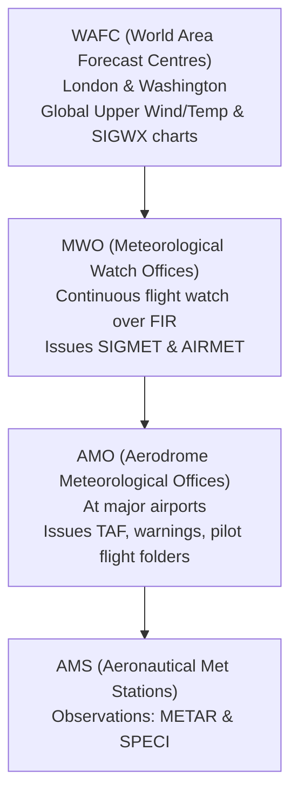
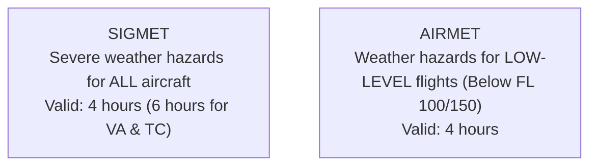

# Chapter 20: Aviation Met Services, SIGMET & Flight Briefing

> **DGCA Syllabus:** Meteorological organization for international air navigation, World Area Forecast System (WAFS), Meteorological Watch Offices (MWO), Aerodrome Meteorological Offices (AMO), VOLMET, ATIS, Significant Weather (SIGWX) charts, Upper Wind/Temp charts, SIGMET and AIRMET criteria/validity, Aerodrome warnings, Station Model decoding.  
> **Primary References:** IC Joshi Chapters 21, 24, 27, 28; Oxford/Nordian Chapter 19; Volare Question Bank.

---

## 🚀 1. The Global Aviation Meteorological Framework

---

## ⚠️ 2. SIGMET vs AIRMET: High-Yield Exam Matrix

### Complete Comparative Matrix:
| Parameter | SIGMET | AIRMET |
| :--- | :--- | :--- |
| **Target Aircraft** | **ALL aircraft**, regardless of size or altitude | **Low-level flights** (below FL 100, or FL 150 in mountainous terrain) |
| **Issuing Authority** | **Meteorological Watch Office (MWO)** | **Meteorological Watch Office (MWO)** |
| **Standard Validity**| **$4\text{ hours}$** | **$4\text{ hours}$** |
| **Special Validity** | **$6\text{ hours}$ for Volcanic Ash (`VA`) & Tropical Cyclone (`TC`)** | None |
| **Trigger Phenomena** | - **Severe Turbulence** (`SEV TURB`) - **Severe Icing** (`SEV ICE` / `FZRA`) - **Severe Mountain Waves** (`SEV MTW`) - **Heavy Duststorm / Sandstorm** (`HVY DS` / `HVY SS`) - **Volcanic Ash Cloud** (`VA CLD`) - **Tropical Cyclone** (`TC`) - **Thunderstorms:** Obscured (`OBSC TS`), Embedded (`EMBD TS`), Frequent (`FRQ TS`), Squall Line (`SQL TS`) with or without hail (`GR`) | - Moderate Turbulence (`MOD TURB`) - Moderate Icing (`MOD ICE`) - Moderate Mountain Waves (`MOD MTW`) - Widespread surface wind $>30\text{ kt}$ - Surface visibility $<5,000\text{ m}$ - Isolated/Occasional thunderstorms - Mountain obscuration |

---

## 🗺️ 3. Significant Weather (SIGWX) Charts

SIGWX charts provide a graphical forecast of en-route weather hazards:
1. **High-Level SIGWX:** Covers **FL 250 to FL 630** (standard for jet transports). Depicts Jet streams (speed, height, core), Tropopause heights, CB clouds, CAT areas, Volcanic ash, and Tropical cyclones.
2. **Medium-Level SIGWX:** Covers **FL 100 to FL 250**. Includes icing, turbulence, fronts, freezing levels.
3. **Low-Level SIGWX:** Covers **Surface to FL 100** (or FL 150). Used for general aviation, depicting cloud bases/tops, visibility, and weather.

---

## 📻 4. Operational Met Broadcasts: VOLMET & ATIS

- **VOLMET (Meteorological Information for Aircraft in Flight):**
  - Continuous broadcast of current **METAR, SPECI, and TAF** for designated groups of major international aerodromes.
  - Broadcast via VHF (locally) or HF (long-range over oceanic and desert routes).
- **ATIS (Automatic Terminal Information Service):**
  - Continuous VHF voice broadcast (or D-ATIS datalink) for arriving and departing aircraft at a specific busy airport.
  - Contains: Identification letter (Alpha, Bravo, Charlie...), observation time, active runway, transition level, surface wind, visibility, weather, clouds, temperature, dew point, QNH, and special NOTAM remarks.
  - Updated upon every new METAR/SPECI or immediate operational change.

---

## 📝 5. Practice Exam Questions

#### Q1: What is the maximum validity period for a SIGMET issued for Volcanic Ash or a Tropical Cyclone?
- **A:** 2 hours
- **B:** 4 hours
- **C:** 6 hours
- **D:** 12 hours

<b>View Answer</b>

<b>Correct Answer: Option C (6 hours)</b>  
<i>Explanation:</i> Routine SIGMETs for turbulence, icing, or thunderstorms have a maximum validity of 4 hours. Special SIGMETs for Volcanic Ash (`VA`) and Tropical Cyclones (`TC`) are valid for 6 hours.

#### Q2: Which office is responsible for issuing SIGMET messages within a Flight Information Region (FIR)?
- **A:** World Area Forecast Centre (WAFC).
- **B:** Meteorological Watch Office (MWO).
- **C:** Control Tower (TWR).
- **D:** Airline Flight Operations Center (FOC).

<b>View Answer</b>

<b>Correct Answer: Option B (MWO)</b>.

