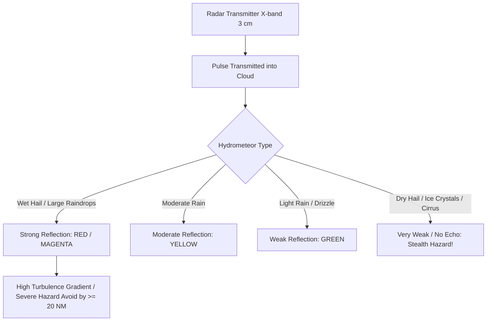
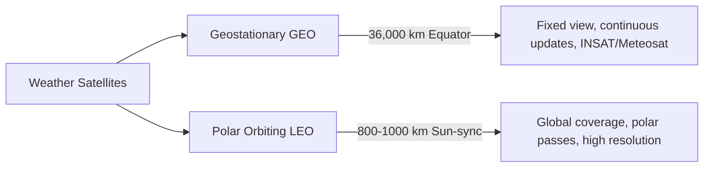
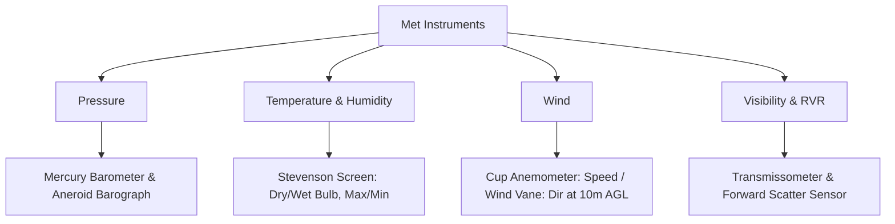

# Chapter 21: Meteorological Radar, Satellites & Instruments

## 1. High-Yield Quick Summary
* **Airborne Weather Radar (AWR):** Primary function is **hazard avoidance** (detecting wet precipitation, turbulence, hail), **NOT** terrain navigation or penetrating severe storms. Operates on **X-band (approx. 3 cm / 9375 MHz)** for optimal balance between antenna size and droplet reflection.
* **Reflectivity:** Radar detects **liquid water droplets** (reflectivity $\propto D^6$, diameter to 6th power). Dry hail and dry snow reflect very weakly; wet hail reflects strongly.
* **Radar Tilt & Beam Geometry:** Beam width typically $3^\circ \text{ to } 5^\circ$. Tilt control is essential to distinguish ground returns from weather cells and to scan storm cores at altitude.
* **Dangerous Radar Signatures:** **Hook echo** (tornado/mesocyclone), **Finger/Pendant echo** (severe updraft/hail), **U-shape / V-notch**, **Steep reflectivity gradient** (color change from green to red in very short distance = severe turbulence).
* **Radar Shadow / Attenuation:** Heavy rainfall attenuates radar pulses; an empty/black area behind an intense red core often hides a deadlier cell (**Radar Shadow / Blind Alley**).
* **Meteorological Satellites:**
  * **Geostationary (GEO):** ~36,000 km over the equator, orbit matches Earth rotation, continuous coverage of same region ($60^\circ \text{N to } 60^\circ \text{S}$). Poor polar resolution (INSAT-3D, METEOSAT).
  * **Polar Orbiting (LEO):** 800–1000 km altitude, sun-synchronous, passes over poles, global high-resolution twice daily.
  * **Spectral Channels:**
    * **Visible (VIS):** Reflects sunlight (daytime only). Thick clouds = Bright white; Water/Land = Dark.
    * **Infrared (IR):** Measures thermal radiation / cloud-top temperature (Day & Night). High cold cloud tops (CB/Cirrus) = Bright white; Low warm clouds = Grey.
    * **Water Vapour (WV):** 6.7 $\mu\text{m}$ channel; detects moisture in mid-to-upper troposphere (jet streams, upper lows), even without visible clouds.
* **Surface Meteorological Instruments:**
  * **Barometer:** Mercury barometer (Kew / Fortin) or Aneroid barometer; calibrated to sea level.
  * **Stevenson Screen:** Double-louvred wooden shelter painted white, 1.25 m (4 ft) above ground, doors open North (in Northern Hemisphere) to prevent direct solar heating during reading. Houses Dry-bulb, Wet-bulb, Maximum, and Minimum thermometers.
  * **Transmissometer & Forward Scatter Meter:** Used to measure Runway Visual Range (RVR).

---

## 2. Core Concept Explanations

### Airborne Weather Radar (AWR)

### Radar Color Coding & Reflectivity Scale (Z)
| Radar Display Color | Reflectivity (dBZ) | Rainfall Rate (mm/hr) | Associated Turbulence / Weather | Pilot Action |
|:---|:---|:---|:---|:---|
| **Black** | $< 20$ | $< 0.5$ (Trace) | None / Light | Safe to fly |
| **Green** | $20 - 30$ | $0.5 - 2.5$ | Light precipitation | Normal transit |
| **Yellow** | $30 - 40$ | $2.5 - 12.5$ | Moderate rain, light-moderate turbulence | Exercise caution |
| **Red** | $40 - 50$ | $12.5 - 50$ | Heavy rain, severe turbulence, hail probable | **AVOID by $\ge 20\text{ NM}$** |
| **Magenta / Purple**| $> 50$ | $> 50$ | Extreme precipitation / Doppler wind shear / Hail | **Immediate divergence** |

### Tilt Angle Management Formula
$$\text{Beam Width Offset (ft)} = \text{Distance (NM)} \times \text{Tilt Angle ($^\circ$)} \times 100$$
* At 60 NM, $1^\circ$ tilt moves beam center by:
  $$60 \times 1 \times 100 \approx 6,000\text{ ft}$$

### Key Radar Hazards & Traps
1. **Radar Attenuation (Shadow Effect):** High-density water droplets absorb the microwave energy, preventing it from reaching clouds beyond. A black hole directly behind a bright red return is almost always **another massive cell hidden behind**, not clear sky.
2. **Stealth Hail (Upper Levels):** Above the freezing level, hail is dry. Dry ice reflectivity is **approx. 1/5th (17%)** of equivalent liquid water. A dry hail shaft will paint green or not at all on radar, but causes catastrophic airframe damage.
3. **Ground Clutter:** Mountains and terrain return strong signals. Tilting radar upwards at lower altitudes avoids confusing ground targets with storm cells.

---

## 3. Meteorological Satellites

### Satellite Imagery Comparison Table
| Image Type | Spectral Band | Daytime Only? | Principle | Interpretation |
|:---|:---|:---|:---|:---|
| **Visible (VIS)** | $0.6 - 0.9\,\mu\text{m}$ | **Yes** (Requires daylight) | Albedo (reflected sunlight). High albedo = bright white. | Thick stratus & CB = Bright white; Clear land = Dark/Grey; Sea = Black. |
| **Infrared (IR)** | $10.5 - 12.5\,\mu\text{m}$| **No** (Day and Night) | Thermal radiation (Stefan-Boltzmann). Cold = Bright white; Warm = Dark. | High clouds (CB tops, Cirrus) = Bright white; Low clouds/Fog = Dark grey; Warm earth = Black. |
| **Water Vapour (WV)**| $6.7\,\mu\text{m}$ | **No** (Day and Night) | Absorption/emission by water vapour at 400–200 hPa. | Identifies Jet streams, upper troughs, moisture curls even if no condensation has formed. |

---

## 4. Meteorological Instruments (ICAO / IMD Standards)

* **Stevenson Screen Standard:**
  * **Height:** Thermometer bulbs at **1.25 to 2.0 m (4 to 6.5 ft)** above ground.
  * **Orientation:** Door opens **facing North** in Northern Hemisphere (prevents direct sun falling on thermometers while reading).
  * **Color & Construction:** Painted double-coated **gloss white** with double louvres for free airflow and thermal reflection.
* **Wind Measurement:**
  * Standard anemometer mast height is **10 m (33 ft)** above ground in open, undisturbed terrain.
  * Gust reported if peak wind exceeds mean by $\ge 10\text{ kt}$ during the observation period.
* **Runway Visual Range (RVR) Instruments:**
  * **Transmissometer:** Light projector and receiver separated by a fixed baseline (e.g., 30–50 m). Attenuation of light beam gives transmissivity $\rightarrow$ converted to RVR.
  * **Forward-scatter Meter:** Measures light scattered forward at an angle ($30^\circ - 45^\circ$); compact single-unit mast.

---

## 5. DGCA CPL/ATPL Golden Key Takeaways

1. **Airborne Weather Radar Wavelength:** **X-band ($\sim 3\text{ cm}$ / 9375 MHz)** is standard for airborne radar. Ground weather radars use **S-band (10 cm)** or **C-band (5 cm)** to minimize attenuation over long ranges.
2. **Avoidance Distance:** Avoid severe CB / Red echoes by at least:
   * **$20\text{ NM}$ laterally** at cruise altitudes ($\ge \text{FL200}$).
   * **$5,000\text{ ft}$ vertically** over cloud top if clearing above.
   * Never fly beneath the anvil of a severe CB (severe turbulence, hail, microburst).
3. **Hail Return vs Rain Return:** Liquid water reflects **approx. 5 times more power** than dry ice of the same diameter; however, hail is typically much larger ($D^6$ factor dominates when wet).
4. **Blind Alley Trap:** Flying between two intense radar echoes with a narrow gap. Turbulence can merge echoes, trapping the aircraft. Maintain minimum **40 NM** clearance between cells.
5. **Geostationary Satellite Invisibility:** GEO satellites cannot image polar regions (above $75^\circ - 80^\circ$ latitude) due to the extreme curvature angle (oblique horizon). Polar-orbiting satellites are required for polar routes.

---

## 6. Question Bank Reference
* Test your concepts with:
  * [`question_bank/06_metar_taf_briefing.md`](../question_bank/06_metar_taf_briefing.md)
  * [`question_bank/08_thunderstorms_hazards.md`](../question_bank/08_thunderstorms_hazards.md)
  * Run the interactive quiz CLI: `python scripts/interactive_quiz.py`
